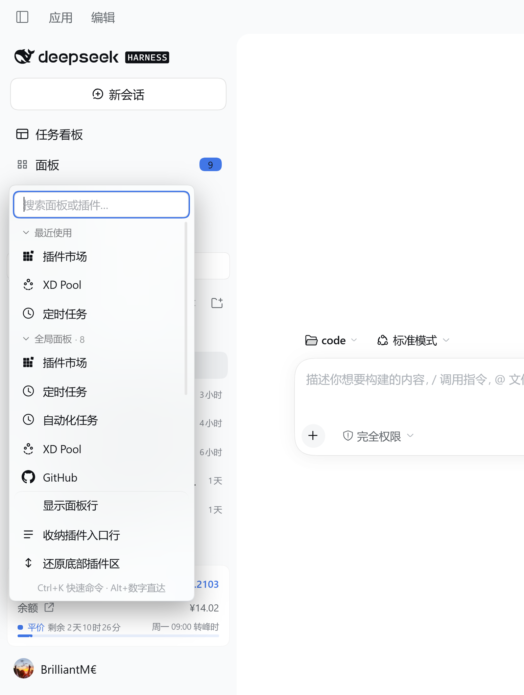
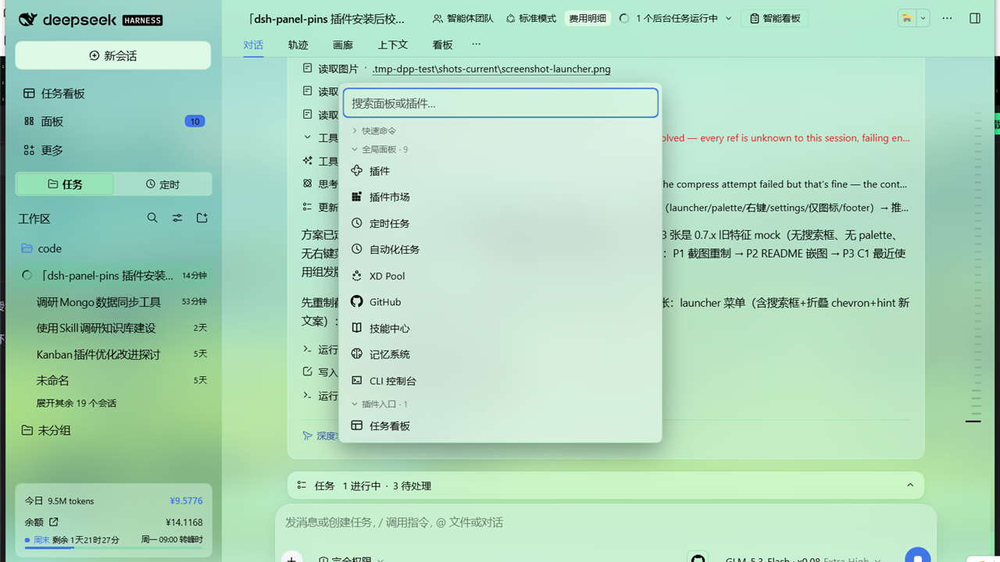
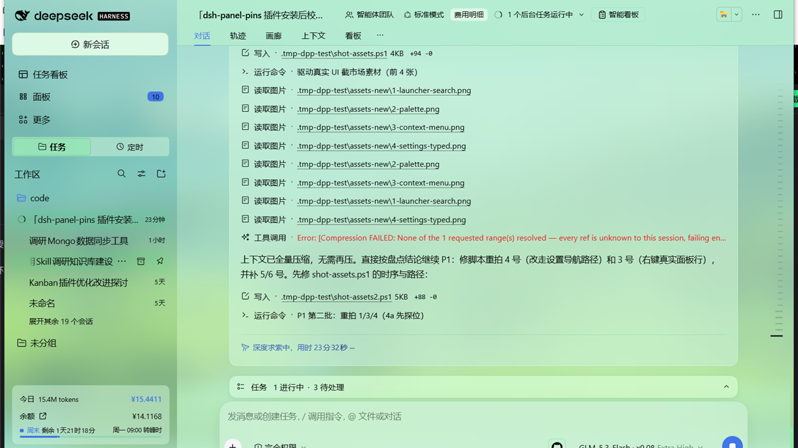
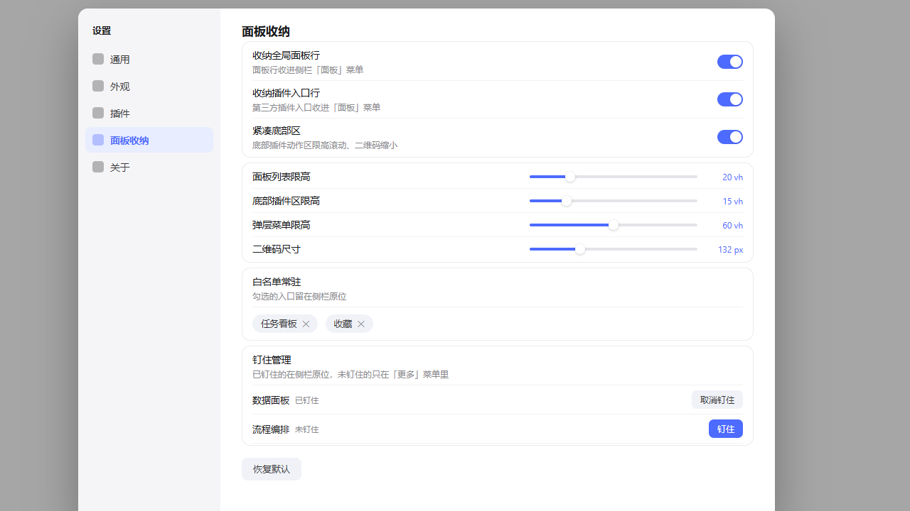
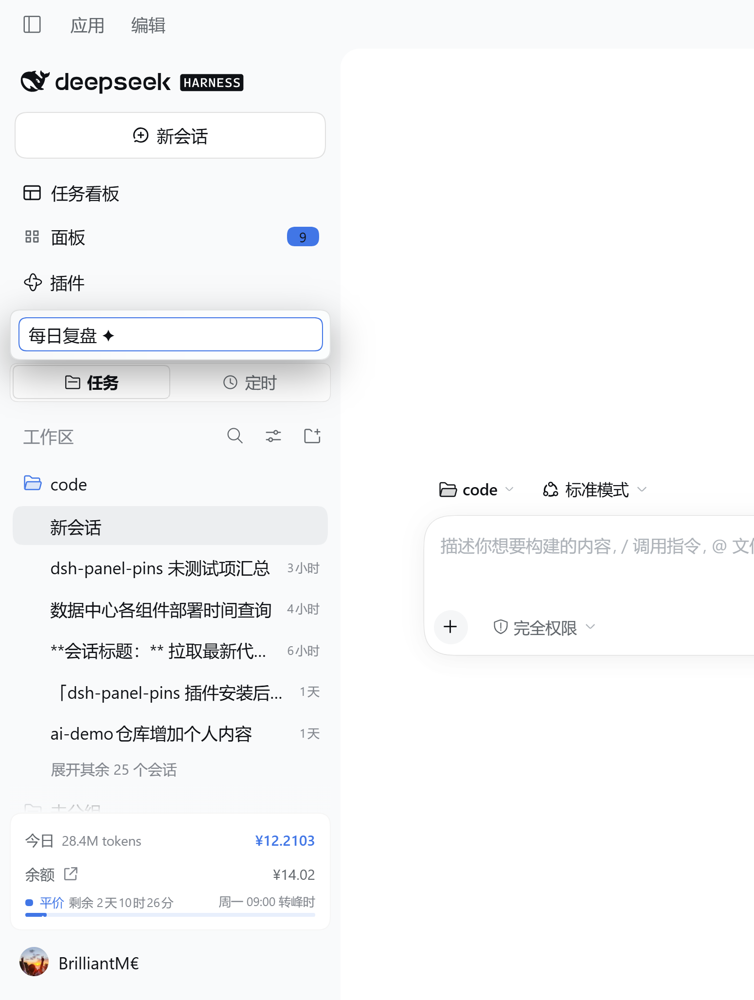
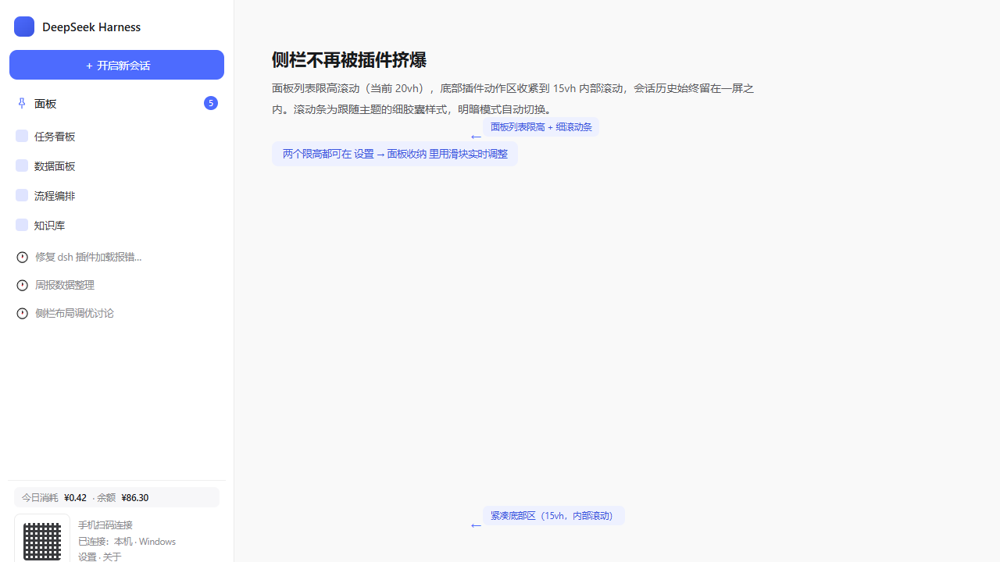

<p align="center"></p>

# dsh-panel-pins

[](https://www.npmjs.com/package/@qdnbd/dsh-panel-pins)
[](LICENSE)


**English** | [中文](README.zh.md)

Your sidebar grows one row per installed plugin — the panel you need gets pushed out of view, and the session list gets squeezed. **dsh-panel-pins hands the sidebar back to you**: collect every panel row and third-party plugin entry into one searchable, grouped launcher menu, decide which rows stay in the sidebar, what they are called and in what order — pin the ones you love, jump anywhere from the keyboard, and tune it all from a dedicated Settings page.

Everything it changes is display-layer only: reload the page and the host looks exactly as it did before you installed it.


<p align="center">
  <a href="assets/screenshot-launcher.png"></a>
  <a href="assets/screenshot-palette.png"></a>
</p>
<p align="center">
  <a href="assets/screenshot-context.png"></a>
  <a href="assets/screenshot-settings.png"></a>
</p>
<p align="center">
  <a href="assets/screenshot-rename.png"></a>
  <a href="assets/screenshot-footer.png"></a>
</p>

## Features

- **Panels launcher** — a first-class row in the sidebar (pixel-aligned with host rows) opens a grouped menu:
  - *Global panels* — the **full panel inventory** (pinned and unpinned alike), with the currently open one highlighted; unpinned panels open via a temporary-pin "peek" that restores your pin state afterwards.
  - *Plugin entries* — third-party plugin entry rows are auto-detected (zero hard-coded selectors; derived structurally between the new-session anchor and the panel list) and can be opened via the menu; clicking fires the **original** button so each plugin's own open logic is untouched.
  - **In-menu search** with full keyboard navigation (type to filter, ↑↓ to move, Enter to open, Esc to close) and **search-hit highlighting** — the matched substring lights up in the theme accent color.
  - **Alt+1..9 direct activation** — while the menu or palette is open, jump straight to the Nth *visible* item (folded/filtered items are skipped).
  - **Collapsible groups with memory** — fold each group; the state survives menu re-opens and app restarts.
  - Hover any line for quick **pin / unpin / to-top** actions.
  - The launcher badge counts everything collected, so nothing is silently "lost".
- **Ctrl+K command palette** — the same inventory plus quick commands (collect rows, icon-only mode, compact footer, open Settings), centered and keyboard-first. Host text inputs are never hijacked.
- **Layout presets** (v1.0.0) — capture your whole layout (pins, top pins, group folds, whitelist, icon-only, compact footer) as a named preset; apply it from the palette or Settings with one click, or delete it. Great for switching between "work" and "play" arrangements.
- **Custom panel groups** (v1.0.0) — define your own groups (e.g. "daily"), assign panels to them from Settings (inline rename, member picker), and they render as first-class groups in the menu and palette — pulled out of the global list, with accurate per-group counts.
- **Hide & rename sidebar rows** (v1.1.0) — right-click any row to hide it from the sidebar (restore it from Settings, or from the *Hidden rows* group in the menu) or rename it display-only (**floating editor**: pops up right below the row and tracks scrolling/folding live; survives the sidebar's constant re-renders with zero lost input; Enter commits, Esc cancels; the original label keeps keying pins/groups/whitelist). Stores are id-first, so both survive UI language switches.
- **Recent group** — the menu and palette list your last-used panels (MRU, cap 5, persisted) at the top for one-click return; stays in sync with search, keyboard navigation and Alt+N jumps.
- **Right-click context menu** on any sidebar row — open / pin / unpin / to-top / keep-in-sidebar / hide / rename, all keyboard-reachable (arrows, Home/End, Enter).
- **Icon-only panel rows** — keep every panel row as a compact 18px glyph column; a gentler middle ground between full rows and full collection.
- **Pin / unpin that survives restarts** — adds pin/unpin rows to the sidebar's *More* menu; pinned panels sit in the sidebar, unpinned ones stay reachable via the menu.
- **Top-pinning with drag-to-reorder** — pin chosen panels to the very top (works in the collapsed icon rail too); reorder them by drag & drop in Settings. Implemented with negative CSS `order`, so no DOM surgery and no fights with host re-renders.
- **Per-group fold toggles** — hide global panel rows and/or plugin entry rows independently; both persisted.
- **Compact footer** (toggleable, on by default) — caps the footer plugin-action area (15vh, internal scroll), shrinks inline pairing QR codes, tightens the brand row and cost-meter. Sub-toggles for QR scaling / brand row / cost meter, plus height sliders.
- **Settings page section** — *Settings → 面板收纳*: all toggles, four live height sliders (panel list / footer / popup / QR size), a **whitelist** to keep specific entries permanently in the sidebar (id-first storage, so it survives UI language switches), a **pin management** list with drag-to-reorder, and **settings export/import** (clipboard JSON) to move your setup between machines.
- **Theme-friendly** — menu surface and scrollbars consume host theme tokens (`--dsw-menu-surface-fill`, backdrop filter, scrollbar tokens), so it plays nicely with themes and plugins like `dsh-any-background`. No hard-coded white/gray.

## Install

In DeepSeek Harness Desktop: **Settings → Plugins** and install `@qdnbd/dsh-panel-pins` from a plugin market that lists it, or from a terminal:

```sh
dsh plugin --profile <your-profile> add @qdnbd/dsh-panel-pins
```

Restart the app.

## Usage

- Click the **Panels** row (with the count badge) in the sidebar → grouped, searchable menu of every panel and plugin entry (pinned and unpinned).
- Press **Ctrl+K** anywhere → the centered command palette (quick commands + full inventory).
- **Right-click** any sidebar row → open / pin / to-top / keep-in-sidebar / hide / rename.
- Open **Settings → 面板收纳** for the full control panel: toggles, sliders, whitelist, drag-to-reorder pin management, export/import, reset layout.

## Configuration

All state lives in `localStorage` under the `dsh-panel-pins:` prefix and survives restarts:

| Key | Meaning |
| --- | --- |
| `rows-hidden-v2` | Global panel rows collected into the launcher |
| `family-collected` | Plugin entry rows collected into the launcher |
| `icon-only` | Panel rows collapse to 18px glyphs |
| `overlay-groups-folded` | Per-group fold memory for the launcher menu |
| `tidy` / `tidy-qr` / `tidy-brand` / `tidy-meter` | Compact footer master + sub-toggles |
| `panel-list-max` / `foot-max` / `overlay-max` / `qr-size` | Height caps (vh/px) |
| `whitelist` | Entries that stay in the sidebar (panel ids first, labels as legacy fallback) |
| `unpinned` / `label-id-map` | Pin state and label→id memory for pin management |
| `top` | Ordered list of top-pinned panel ids (array order = display order) |
| `hidden-rows` | Rows hidden from the sidebar (v2 id-first entries `{id,label}`; legacy label arrays auto-migrated) |
| `display-renames` | Display-name overrides (v2 id-first entries `{id,label,name}`; legacy label maps auto-migrated) |
| `layout-presets` / `active-preset` | Named layout presets and the last applied one |
| `custom-groups` | User-defined panel groups (id → {name, labels}) |
| `recent-panels` | Recently opened panels (MRU, cap 5) |

## Notes

- Bottom footer entries are **never** folded into the menu — they stay in place; only their container gets a height cap with internal scrolling.
- The plugin never rewrites host stylesheets per frame; everything is gated on classes / CSS custom properties, so toggling is instant and flicker-free.

## Boundaries & safety

- **Display layer only.** Hiding and renaming change what *you* see in this one install — they never touch plugin loading, a plugin's registered name, or the plugin's own configuration. Rename is a pure visual override: the sidebar row, its tooltip and its accessible name follow your label; everything else (pins, groups, whitelist, palette) keeps keying off the original.
- **No DOM surgery.** Ordering uses CSS `order`, hiding uses `display`, marking uses `data-dpp-*` attributes — no React nodes are moved and no host code is patched, so host re-renders never break the layout.
- **Clean uninstall.** All state lives under the `dsh-panel-pins:` localStorage prefix; reload the page after removing the plugin and the host is back to stock, pixel for pixel.
- **Theme-token styling.** Menus, floats and scrollbars consume host theme tokens (`--dsw-alias-*` / `--dsh-*`) with zero hard-coded colors — light, dark and third-party themes like `dsh-any-background` all work.

## Troubleshooting

- **Installed but no "Panels" row appears** — restart the app once; the sidebar module is generated at boot.
- **Sidebar looks empty after enabling collection** — that is the point 🙂; click the **Panels** row (or press Ctrl+K) to reach everything. To keep a row permanently visible, right-click it → *Keep in sidebar*.
- **A renamed row shows odd text or the editor misbehaves** — update to **v1.1.1+**, where the rename editor is a body-level floating overlay that survives the sidebar's constant re-renders.
- **Toggles changed but nothing happens** — reload the page once; a stale bundle revision may be cached.
- **Something looks broken after a host update** — check `engines.dsh` compatibility in this repo's `package.json`; the plugin declares a supported host range and is hidden by markets outside it.

## License

[MIT](LICENSE) © 2026 QDNBD
