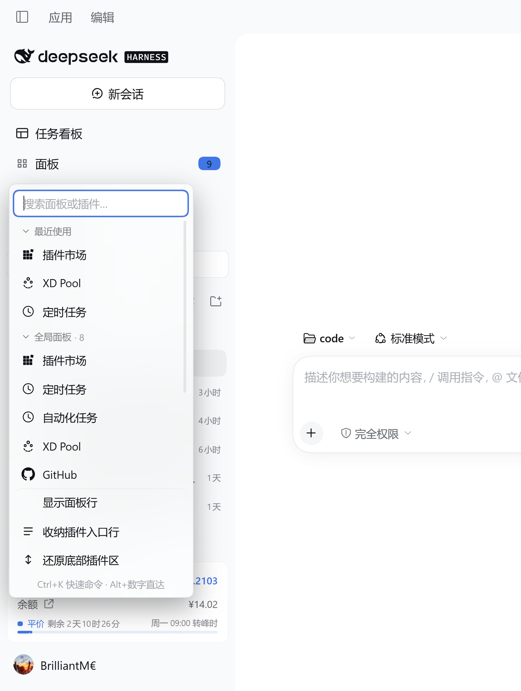
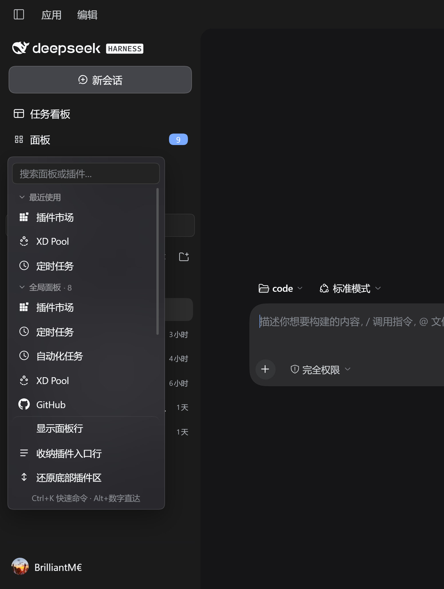
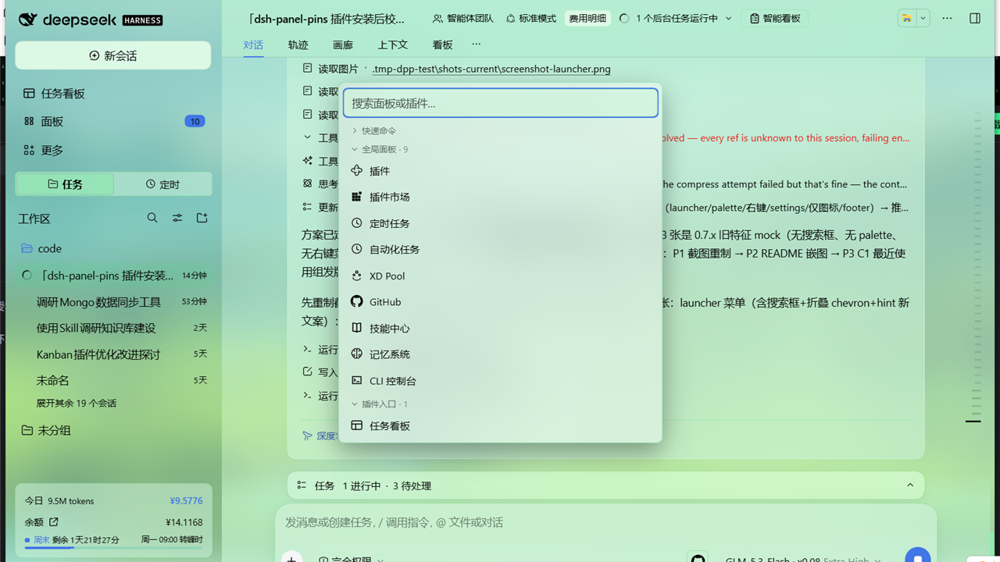
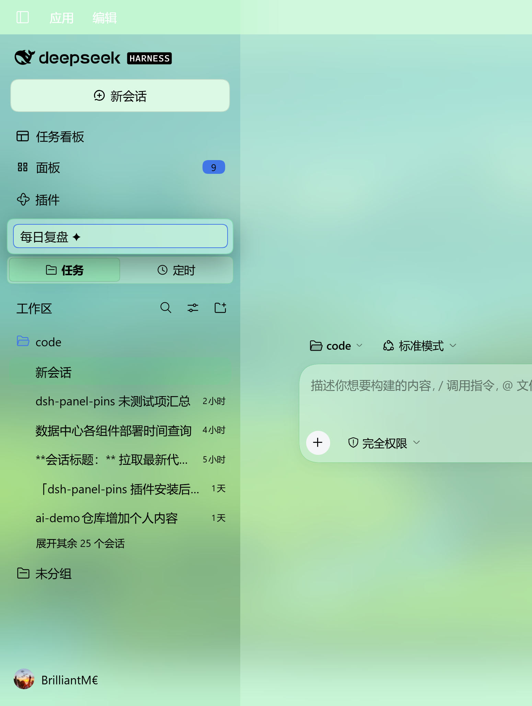
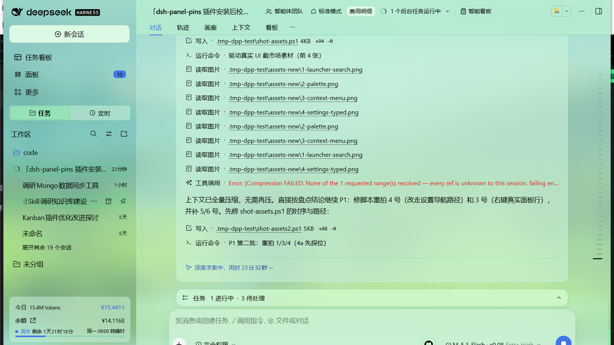
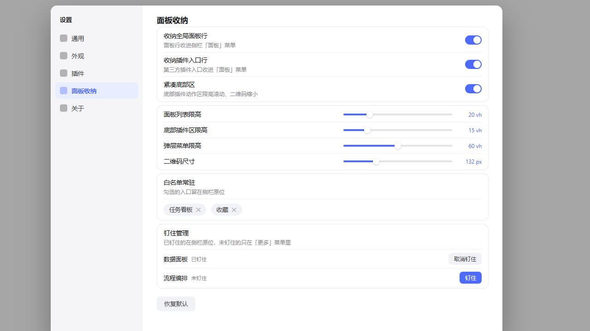

<p align="center"></p>

# dsh-panel-pins

[](https://www.npmjs.com/package/dsh-panel-pins)
[](https://www.npmjs.com/package/dsh-panel-pins)
[](LICENSE)


**English** | [中文](README.zh.md)

**A keyboard launcher for your sidebar panels.** Hit `Ctrl+K`, type two letters, press Enter — panels, plugin entries and even third-party pages that only registered a Settings section all live in one searchable menu. The sidebar keeps only the rows you actually want.

```sh
dsh plugin --profile <your-profile> add dsh-panel-pins
```

By the tenth plugin the sidebar is out of control: what you use daily is buried in *More*, the session list is squeezed to a slit, and opening a panel means scrolling, expanding, then hunting.

**dsh-panel-pins does not tidy your sidebar — it makes opening the sidebar unnecessary.**


<p align="center">
  <a href="assets/screenshot-launcher.png"></a>
  <a href="assets/screenshot-launcher-dark.png"></a>
</p>
<p align="center">
  <a href="assets/screenshot-palette.png"></a>
  <a href="assets/screenshot-rename.png"></a>
</p>
<p align="center">
  <a href="assets/screenshot-context.png"></a>
  <a href="assets/screenshot-settings.png"></a>
</p>

## ✨ Highlights

- **⌨️ Any panel in two keystrokes** — a global `Ctrl+K` palette with instant search and hit highlighting, `Alt+1..9` direct jumps, and a Recent group that keeps your high-frequency panels on top. The sidebar becomes optional. The binding lives in the **host's own shortcut service**, so you can rebind it in *Settings → Shortcuts*.
- **🔤 Search it in pinyin** — type `mbsn` to find 面板收纳, `mianban` to find 面板. The full GB2312 common-hanzi table ships in the plugin: **purely local, nothing leaves the machine**. Hits are ranked, so the best match lands on the first row.
- **🖱️ Drag anything, anywhere** — grab any panel or plugin row and drop it where it belongs; a **blue insertion line** marks the exact landing spot. Works right in the sidebar *and* in the pinned manager, and touch users can drag too (long-press 500ms, v1.8) — a hold-and-release without moving opens the right-click menu. One click restores the host's default order.
- **✏️ Make every row yours** — right-click to hide a row, rename it with a floating editor anchored under the row, pin it, or push it to the top. Display-only, survives restarts and language switches.
- **💾 Named layout presets** — pins, folds, icon-only and the compact footer snapshot into one preset; flip "work" ↔ "play" in one click from the palette.
- **🧲 Nothing is unreachable** — third-party plugins that only registered a Settings page get their full page as a row in the menu; plugins that only registered a **main panel** land in the *Main panels* group; the host's own **right-sidebar tab types** get a group of their own.
- **🌐 Follows the host's language and theme** — the plugin reads the host's own language setting (8 languages) and repaints the moment you switch it; the theme follows the host instantly instead of lagging a beat behind.
- **🧊 A sidebar that stays slim** — icon-only mode (18px glyph column) plus a compact footer with four independent height caps, so the session list never gets squeezed to a slit again.
- **🛡️ Zero risk, zero residue** — display layer only, no DOM surgery, host re-render-proof; uninstall and the sidebar is pixel-identical to before. Light / dark / wallpaper themes all work.

## What it fixes

| Where you are now | Where you land |
| --- | --- |
| A dozen rows; the ones you use got pushed into *More* | Everything sits in one **Panels** menu; the sidebar keeps only what you pinned |
| Opening a panel = scroll → expand → hunt | `Ctrl+K`, two letters, Enter — or `Alt+1..9` while the menu is open |
| Never knew `Ctrl+K` existed | Type `/` in the composer and pick "Open panel launcher" |
| Plugin names are long and cryptic | Rename any row; display-only, the original still keys pins/groups |
| Plugins that only registered a Settings page are unreachable | v1.4 bridges them: their Settings page becomes a row in the menu |
| The host is set to 中文 but the plugin still answers in English | v1.6: the plugin reads the host's own language setting, and repaints the moment you switch it |
| One arrangement for work, another for play | Save each as a named preset and switch from the palette |

## Why this one

Among the eleven sidebar-panel plugins (`panel-control`, `panel-layout`, `panellist`, `panel-compact`, `panel-tidy`, `panel-titlebar`, `panel-order`, `panel-folders`, `panel-collapse`, `panel-fold`, this one), only this plugin does all six:

1. **You never open the sidebar.** A global `Ctrl+K` palette, in-menu search with hit highlighting, `Alt+1..9` jumps and an MRU group — the other ten have none of these.
2. **The shortcut belongs to the host.** `Ctrl+K` is registered with the host's own shortcut service: rebind it, see its conflicts, and let the host decide whether the key may fire instead of the plugin guessing.
3. **Chinese users can actually search.** Pinyin initials (`mbsn` → 面板收纳), full pinyin (`mianban` → 面板) and fuzzy subsequences, over a bundled GB2312 table — **entirely local, nothing is sent anywhere**.
4. **The whole layout saves as a preset.** Pins, top pins, folded groups, whitelist, icon-only and compact footer in one snapshot; restore a scenario in one click.
5. **It speaks the host's language, literally.** The plugin reads the host's own language setting and its theme, so it never shows English under a Chinese host — and it repaints the instant either changes.
6. **The widest host range.** Requires `DSH ≥ 0.2.0-rc.1` and `Node ≥ 20`; `panel-control` / `panel-layout` need `≥ 0.2.1-rc.3`, and `panel-layout` / `panel-tidy` / `panellist` also need `Node ≥ 22`.

### Full comparison (2026-11-26, latest release of each)

> Facts only, no scorekeeping. **Enable one at a time** — they mutate the same sidebar nodes.

| Capability | **This plugin 1.9.0** | [panel-control 0.10.7](https://www.npmjs.com/package/dsh-panel-control) | [panel-layout 0.2.5](https://www.npmjs.com/package/dsh-panel-layout) | [panellist 0.2.0](https://www.npmjs.com/package/dsh-panellist) | [panel-compact 0.1.0](https://www.npmjs.com/package/dsh-panel-compact) | [panel-tidy 0.2.1](https://www.npmjs.com/package/dsh-panel-tidy) | [panel-titlebar 0.3.4](https://www.npmjs.com/package/dsh-panel-titlebar) |
| --- | :-: | :-: | :-: | :-: | :-: | :-: | :-: |
| **Ctrl+K global command palette** | ✅ | — | — | — | — | — | — |
| **Registered in the host's shortcut service (rebindable, conflicts visible)** | ✅ | — | — | — | — | — | — |
| **Pinyin initials / full pinyin / fuzzy matching** | ✅ | — | — | — | — | — | — |
| **Hits ranked by relevance** | ✅ | — | — | — | — | — | — |
| **In-menu search + hit highlighting** | ✅ | — | — | — | — | — | — |
| **Alt+1..9 direct jump** | ✅ | — | — | — | — | — | — |
| **Recent panels (MRU, cap 5)** | ✅ | — | — | — | — | — | — |
| **Named layout presets** | ✅ | — | — | — | — | — | — |
| **Coexists with the host's native Pin (plugin becomes a persistence mirror; native unpin never resurrected)** | ✅ v1.7 | — | — | — | — | — | — | — |
| **UI language follows the host's own language setting** | ✅ v1.6 | — | — | — | — | — | — | — |
| **Theme follows the host instantly (no 5s lag)** | ✅ v1.6 | — | — | — | — | — | — | — |
| Collect sidebar rows into a grouped menu | ✅ panels / plugin entries / settings pages / main panels / right-sidebar tabs | ✅ group tree | partial: overflow + bottom-left trio only | ✅ flyout groups | ✅ keeps 3 rows | ✅ drag into *More* | — |
| Drag-to-reorder sidebar rows | ✅ live drop line | ✅ drag handle | ✅ | ✅ | ✅ | — |
| Hide / rename | ✅ / ✅ floating editor | ✅ / ✅ | overflow only / — | ✅ / ✅ | — / — | — / — | — |
| Custom groups | ✅ | ✅ | — | ✅ | — | — | — |
| Fold state remembered | ✅ | ✅ | — | —（flyout menus） | — | — | — |
| Bridge settings-only plugins into the menu | ✅ v1.4, full parity | ✅ | — | — | — | — | — |
| Bridge **main-panel**-only plugins into the menu | ✅ v1.5 | — | — | — | — | — | — |
| Settings export / import | ✅ clipboard + file + drag-drop | — | — | ✅ file | — | — | — |
| Sidebar area caps | ✅ four independent sliders | ✅ adaptive | ✅ | — | — | — | — |
| Active-row exemption | ✅ | —（self-protection only） | — | ✅ | — | — | — |
| Icon replacement | — | — | — | ✅ 24 built-in | — | — | — |
| Button-row / list layout + row cap | icon-only middle ground | — | ✅ 1–3 rows | — | — | — | — |
| Absorb bottom-left *More* (settings / feedback / sign-in) | — | — | ✅ | — | — | — | — |
| Panel rows moved into the Windows title bar | — | — | — | — | — | — | ✅ |
| AI auto-classification | — | ✅（sends entry names to the model provider） | — | — | — | — | — |
| Touch drag / long-press to pick up a row | ✅ long-press 500ms, drag directly | — | touch uses an up-arrow | — | ✅ | ✅ 500ms hold | — |
| Host range | **≥ 0.2.0-rc.1 / Node ≥ 20** | ≥ 0.2.1-rc.3 | ^0.2.1-rc.3 / Node ≥ 22 | ≥ 0.2.0-rc.2 / Node ≥ 22 | ≥ 0.2.0 | ≥ 0.2.0 / Node ^22.19 | ≥ 0.2.1-0 |

> The remaining four are single-purpose: `panel-order` (sorting only), `panel-folders` (collapsible groups), `panel-collapse` (collapse the panel list), `panel-fold` (fold into *More*).
>
> Source: npm registry `latest` plus each package's README, fetched 2026-11-25. The table records facts only — pick by your priority, see [*Which one?*](#which-one).

## Features

### 1. The Panels launcher: six group types, everything collected

A first-class sidebar row (pixel-aligned with host rows) opens a grouped menu whose badge counts everything collected — nothing is silently lost:

| Group | What is inside |
| --- | --- |
| **Global panels** | The full inventory (pinned and unpinned alike), current one highlighted; unpinned panels open via a temporary-pin *peek* that restores your pin state |
| **Plugin entries** | Third-party entry rows are auto-detected (zero hard-coded selectors; derived structurally between the new-session anchor and the panel list) and fire the **original** button, so each plugin's own open logic is untouched |
| **Settings pages** | v1.4: third-party plugins that registered only a Settings section get their whole page in the menu — click a row to open the full page in the main area |
| **Main panels** | v1.5: third-party plugins that registered only a **main panel** (root `main` slot) and no sidebar row land here — click a row to open it. The host's own conversation column and already-bridged settings pages are excluded |
| **Recent** | MRU, cap 5, persisted — your high-frequency panels stay on top |
| **Custom groups** | Groups you define ("daily"), members pulled out of the global list, per-group counts accurate |
| **Hidden** | Every row you hid from the sidebar, with one-click restore-all |

- **In-menu search** — type to filter, matched substrings light up in the accent color; `↑↓` to move, `Enter` to open, `Esc` to close.
- **Pinyin search (v1.5)** — besides typing Chinese, type **pinyin initials** (`mbsn` → 面板收纳), **full pinyin** (`mianban` → 面板) or a **fuzzy subsequence** (`dpp` → dsh-panel-pins). The complete GB2312 common-hanzi table ships inside the plugin; matching is computed locally, never over the network.
- **Relevance ranking (v1.5)** — while searching, the closest match moves to the **first row of its group** (exact > prefix > initials > substring > fuzzy). Clearing the box restores the original order.
- **`Alt+1..9`** — jump to the Nth *visible* item (folded or filtered ones are skipped). After a search, `Alt+1` is the best hit.
- **Fold memory** — per-group folding survives re-opens and restarts.
- **Hover actions** — pin / unpin / to-top on any row.

### 2. The `Ctrl+K` palette

The same inventory plus quick commands (collect rows, collect plugin entries, icon-only, compact footer, open Settings). Centered, keyboard-first, and it **never hijacks a focused host input**.

Since v1.5 `Ctrl+K` is registered with the host's shortcut service (`ctx.shortcuts`): rebind it under *Settings → Shortcuts*, and let the host detect conflicts. The host decides whether the key may fire (focused input, open modal) instead of the plugin guessing. On older hosts without the service — or when the host already owns `Ctrl+K` — the plugin falls back to its own listener and nothing is lost. On macOS the key is `⌘K`, matching the host's other shortcuts.

### 3. Sidebar management

- **Pin / unpin** — added to the sidebar's *More* menu on legacy hosts, persisted across restarts; once the host ships its own native pin (0.2.2-rc.5), the plugin steps aside — it stops rendering duplicate pin rows and becomes a **pure persistence mirror**: restarts that wipe the host's memory store are restored by the plugin, and every native unpin is remembered.
- **Top-pin + drag to reorder** — grab any panel or plugin row, drag it to its target; a **blue insertion line** shows the drop point. Same in Settings → pinned manager. Touch fallback: long-press 500ms and drag directly (v1.8); hold-and-release without moving opens the right-click menu. Backed by `row-order` plus negative CSS `order`, so no DOM surgery and no fights with host re-renders.
- **Reset row order** — when you have moved enough rows, one click returns to the host's default order.
- **Hide** — right-click any row to remove it; restore from Settings or the *Hidden* group (with restore-all once you have ≥2).
- **Rename** — display-only override via a **floating editor** anchored under the row, tracking scroll and folding live, surviving the sidebar's constant re-renders with zero lost input (`Enter` commit / `Esc` cancel). Id-first storage survives UI language switches.
- **Icon-only mode** — rows keep their place but collapse to an 18px glyph column; a gentler middle ground than full collection.
- **Whitelist** — rows that always stay in the sidebar; beats every collection rule. Id-first.
- **Active-row exemption** — a hidden row that *is* the panel you are currently in comes back temporarily; leaving re-hides it. Collection still wins, whitelist still wins over everything.
- **Independent group switches** — global panels, plugin entries and bottom plugin entries collect separately, each persisted.

### 4. Layout presets and custom groups

Capture pins / top pins / folded groups / whitelist / icon-only / compact footer as a named preset; apply or delete it from the palette or Settings. Switch "work" and "play" in one click.

### 5. Compact footer

Caps the bottom plugin action area at 15vh with internal scrolling, shrinks the inline QR code, tightens the brand row and cost meter. Separate toggles for QR / brand / meter plus a height slider. Bottom entries are **never** collected into the menu — they stay put; only the container is capped.

### 6. Settings: one console

*Settings → Panel pins*:

| Card | Contents |
| --- | --- |
| Toggles | collect panel rows / collect plugin entries / icon-only / compact footer / settings-page bridging / three sub-toggles |
| Sliders | panel list cap, footer cap, overlay cap, QR size (live) |
| Layout presets | save / apply / delete |
| Pinned manager | one view of everything; top-pin and drag-reorder |
| Row order | shows "N rows customised", one-click reset |
| Custom groups | create, rename, add members via the **+ panel** picker |
| Whitelist | edit the always-visible set |
| Hidden rows / Renamed rows | restore individually |
| Settings entries | bridging switch |
| Feedback & diagnostics | GitHub issue / survey / copy diagnostics |
| Export & import | clipboard, file and drag-drop; restore default layout |

### 7. Settings-page bridging (v1.4)

A third-party plugin that registered only a Settings section is installed but unreachable. Since v1.4 the menu carries a **Settings pages** group:

- the page renders through the plugin's own registration surface (`inject` / `store` / `locale` passed through at top level), so it is the **full page**, not a crippled mirror;
- a *Back to chat* bar sits at the top;
- rows reconcile add/remove only (never re-mounted mid-interaction); one switch collects them all;
- retracting while you are on that page lands you back in chat; uninstall leaves no residue.

### 8. Feedback and diagnostics (zero automatic reporting)

Settings card plus a palette command:

- **Open a GitHub issue** — title and environment pre-filled (plugin version + build, host version, platform, language), all editable;
- **Take the survey** — opens the **plugin owner's own** form (submissions land where the author actually reads them, never the host's official questionnaire);
- **Copy diagnostics** — config export plus an environment block to your clipboard; pasting it into an issue is your call.

Nothing is ever attached to a URL automatically and nothing is reported in the background.

### 9. Migration

- **Clipboard**: export JSON / paste to import;
- **File**: download `dsh-panel-pins-settings.json`, restore on another machine;
- **Drag-drop**: drop the JSON straight onto the Settings panel;
- all three share one export constructor and replay path, guarded by a `__plugin` sentinel — foreign JSON is rejected.

## 60-second start

| I want to… | Do this |
| --- | --- |
| Clean up the sidebar | Settings → Panel pins → turn on *Collect panel rows* |
| Jump to a panel now | `Ctrl+K` → type its name → `Enter` |
| Put a row back | Hover it → pin icon; or right-click → *Pin* |
| Give a plugin a short name | Right-click → *Rename* → type → `Enter` |
| Move something | Drag the row onto its target (blue line = drop point) |
| Save a "work" arrangement | Adjust → palette → *Save current layout as preset* |
| Undo everything | Settings → Panel pins → *Restore default layout* |

## Install

```sh
dsh plugin --profile <your-profile> add dsh-panel-pins
```

Or in the DeepSeek Harness desktop app: **Settings → Plugins**, search the marketplace. **Restart the app once** afterwards (the sidebar module is built at startup).

> **Single package name**: only the bare name `dsh-panel-pins` is published. The old `@qdnbd/dsh-panel-pins` is frozen at 1.2.1 and **will not be updated**.
>
> If you installed the scoped name you are running 1.2.1, which has **no** settings-page bridging, no layout presets, no export/import and no drag-to-reorder. Install the bare package (`dsh plugin --profile <your profile> add dsh-panel-pins`) and move your configuration across with *Export / Import* in the old settings page — both package names share the same `dsh-panel-pins:` localStorage prefix, so the import lands as-is.

## Configuration

All state lives under the `dsh-panel-pins:` prefix in `localStorage` and survives restarts:

| Key | Meaning |
| --- | --- |
| `rows-hidden-v2` | Global panel rows collected into the launcher |
| `family-collected` / `footer-collected` | Plugin entry rows / bottom plugin entry rows collected |
| `icon-only` | Panel rows collapse to an 18px icon column |
| `overlay-groups-folded` | Per-group fold memory |
| `tidy` / `tidy-qr` / `tidy-brand` / `tidy-meter` | Compact footer master + three sub-toggles |
| `panel-list-max` / `foot-max` / `overlay-max` / `qr-size` | Area caps (vh/px) |
| `whitelist` | Always-visible entries (id-first, legacy label fallback) |
| `unpinned` / `label-id-map` | Pin state and label→id memory |
| `top` | Ordered list of top-pinned panel ids |
| `row-order` | Row order after drag / move-to-front (overrides host default) |
| `hidden-rows` | Rows hidden from the sidebar (v2 id-first entries) |
| `display-renames` | Display-name overrides (v2 id-first entries) |
| `layout-presets` / `active-preset` | Named presets and the last applied one |
| `custom-groups` | User-defined panel groups |
| `recent-panels` | MRU, cap 5 |
| `bridge` | Settings-page bridging switch and state |

## Boundaries and safety

- **Display layer only.** Hiding and renaming affect what this installation shows — never plugin loading, registered names or a plugin's own config. Rename is a pure visual override; pins, groups, whitelist and the palette still key on the original label.
- **No DOM surgery.** Ordering uses CSS `order`, hiding uses `display`, marking uses `data-dpp-*` — no React nodes moved, no host patches, so host re-renders can never break your layout.
- **Clean uninstall.** Everything lives under `dsh-panel-pins:`; remove the plugin, reload, and the host is pixel-identical to before.
- **Theme tokens.** Menu, overlays and scrollbars consume host `--dsw-*` / `--dsh-*` tokens — light, dark and wallpaper plugins such as `dsh-any-background` all work.
- **Zero automatic reporting.** Nothing leaves the machine until you click, and you see the content first.
- **Public contracts only.** Panel inventory, settings sections and pinning go through host slots and optional services; a failed read degrades to "not active", never a crash.

## Which one?

All eleven work on the same sidebar with different aims. **Enable only one at a time** — they manipulate the same rows and will fight each other.

| If your priority is… | Pick |
| --- | --- |
| A tangle of sidebar rows; want one entry for everything + keyboard | **this plugin** |
| Just tidy the rows, mouse is fine | this plugin / panellist / panel-tidy; this one adds search and a palette |
| A "button rows, 1–3 lines" grid look | panel-layout |
| Moving the panel rows into the Windows title bar to reclaim vertical space | panel-titlebar |
| Keep only three rows, everything else in *More*, minimal config | panel-compact |
| Automatic grouping by an AI model | panel-control |
| A custom icon per panel | panellist |
| Touch-first, long-press to drag | panel-tidy |

## Troubleshooting

- **No "Panels" row after installing** — restart the app once; the sidebar module is built at startup.
- **Sidebar is empty after enabling collection** — that is the point; click the *Panels* row or press `Ctrl+K`.
- **A toggle does nothing** — reload the page; you may be on a stale bundle revision.
- **Rename editor misbehaves / loses input** — upgrade to v1.1.1+ (rewritten as an overlay attached to `body`).
- **Plugin vanished after a host upgrade** — check `engines.dsh` in `package.json`; outside the range the marketplace hides it until a release widens it.

## Development

Client code lives as modules under `src/` (numeric filename prefixes define the concatenation order); `scripts/build-client.mjs` joins them into the single `lib/client.js` the host evaluates. **Edit `src/`, never `lib/client.js` by hand** — pack.ps1 rebuilds automatically and refuses to pack when any src file is newer than the built lib (stale-build guard). The modules are ordered byte-range concatenation (the host evaluates exactly one client file per plugin); the split output was once verified byte-identical to the pre-split monolith.

## Releases

Actively maintained, usually one version every 1–3 days. Recent:

- **1.9.0** — **slash-menu discoverability**: one new row in the host's own `/` command menu — "Open panel launcher". Users who never learned about `Ctrl+K` now see the entry the moment they type `/`; typing `/launch` ranks the row into view without scrolling, and clicking it opens OUR palette with full pinyin search (the host shell has no pinyin, so we contribute the entry only, never the whole catalog). Hosts without the command menu skip it silently.
- **1.8.0** — two new capabilities: **touch drag at last** — press a sidebar row for 500ms to arm the drag (haptic tick), a blue insertion line marks the drop point live, release to commit; releasing a hold without moving opens the row context menu (hide/rename/pin all reachable), and an early swipe still hands off to scrolling. The mouse drag path is unchanged. **Collapsed-sidebar badge** — while the sidebar is collapsed, the expand button shows "N rows folded into the launcher"; nothing folded means no badge, and hosts without the slot skip it silently.
- **1.7.1** — two polish items: the transient toast now consumes the host's own toast tokens (`--dsw-alias-toast-bg/-label`), so it looks exactly like the host's native toasts (dark surface, both palettes); the overlay menu gained proper accessibility semantics — the container moves from an invalid `role="menu"` to `dialog`, the list is a `listbox` with a stable id, rows are `option`s, the search input is a `combobox`, and the ↑↓ keyboard highlight is exposed to screen readers via `aria-activedescendant` (previously a screen reader had no idea which row was highlighted). No behaviour or visual change beyond the toast surface.
- **1.7.0** — **Pin dual-source convergence**: once the host shipped its own native pin (0.2.2-rc.5), pin state lived in two places (host memory + plugin storage) and a native unpin was silently resurrected by the plugin (verified on the real app: reopening the menu brought the row back). The plugin now detects the native controls, hides its own pin rows, and becomes a pure persistence mirror — **the host owns the interaction, the plugin owns the memory**: every native unpin is recorded and restored after a restart, never resurrected. Legacy hosts without native pins behave exactly as before.
- **1.6.1** — fix: the sidebar's **New-session button** looked half-empty, because the plugin's own stylesheet matched more than it should — `[class*="_newSession"]` also caught the button's inner label and content spans, so the extra margin pushed the "+ 新会话" text 8px above the button's vertical middle. The gap now applies to the row only, and the text is centred again
- **1.6.0** — three more: the host's **right-sidebar tab types** join the menu in a group of their own (page types only — a resource type is opened by address, not by name, so listing it would open a broken tab); the plugin's **UI language now follows the host's own language setting** (8 languages, switchable in-app) instead of guessing from `navigator.language`; and the **theme follows the host instantly** — the old observer watched a `<html>` class the host never touches, so a theme switch could take up to five seconds to land
- **1.5.0** — three things: `Ctrl+K` moves into the host's shortcut service (rebindable under *Settings → Shortcuts*, conflicts visible, the host arbitrates inputs and modals); search understands pinyin initials, full pinyin and fuzzy subsequences and ranks hits by relevance; third-party plugins that ship only a **main panel** join the launcher's *Main panels* group
- **1.4.8** — fix the capped panel list still not wheel-scrolling on rc.5 (v1.4.4's driver-free cap): the lite driver absorbs only list-capable steps and passes boundary steps through untouched; v1.4.7's truncated stylesheet (a duplicated selector line silently dropped every rule after it) is reverted — the stylesheet is byte-identical to 1.4.4 again
- **1.4.7** — bring back the capped panel list on rc.5 (user request): a lite wheel driver absorbs only list-capable steps and passes every list-boundary step through to the host hand-off untouched — list and workspace alive together for the first time
- **1.4.6** — the plugin steps aside from the scroll layer on rc.5: no panel-list cap, no wheel handling (the host hand-off replaces what the cap was for; any plugin scroll handling broke one of the two regions)
- **1.4.5** — fix the capped panel list itself refusing to scroll (the rc.5 viewport handler swallowed every wheel event; a chained driver now mirrors the host hand-off: list first, remainder spills to the viewport)
- **1.4.4** — fix the rc.5 sidebar workspace region refusing to scroll (the rc.3-era structural override CSS is now gated on the host scroll contract)
- **1.4.3** — build tag (bNN) removed from user-visible surfaces; it stays in `?dppdebug` only
- **1.4.2** — the plugin's own settings section is bridged too; row count matches settings-entry count exactly
- **1.4.1** — bridging at full parity: every `settings.section` becomes a launcher row
- **1.4.0** — settings-only third-party plugins enter the Panels menu (main-keyed panel, original inject/store/locale passed through)
- **1.3.3** — feedback & diagnostics: pre-filled issue, author survey, manual diagnostics copy, zero automatic reporting
- **1.3.2** — active-row exemption: the entry stays while you are on the page
- **1.2.2** — direct drag-to-reorder sidebar rows + move-to-front fallback

Full history in [Releases](https://github.com/QDNBD/dsh-panel-pins/releases).

## License

[MIT](LICENSE) © 2026 QDNBD
