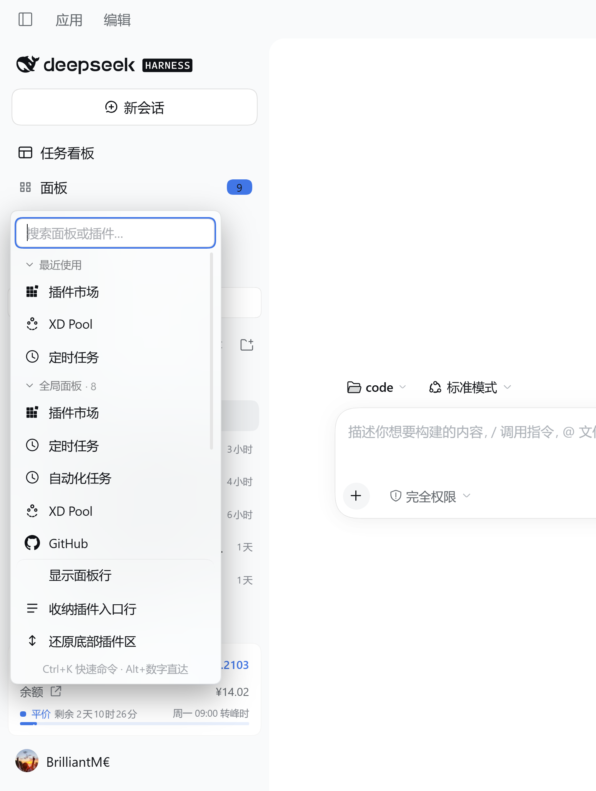
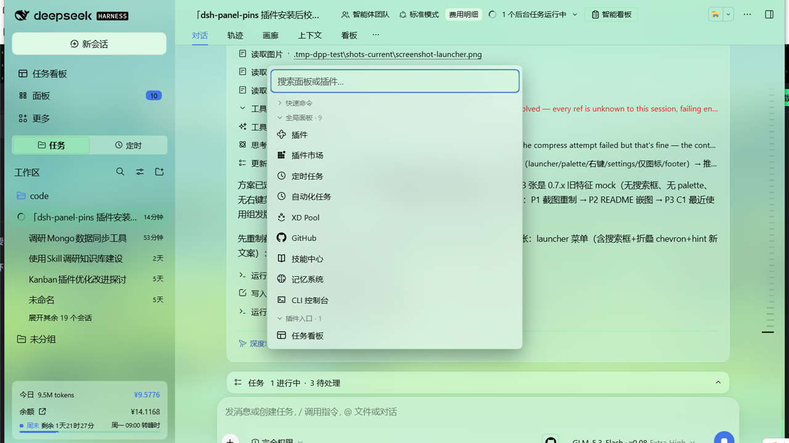
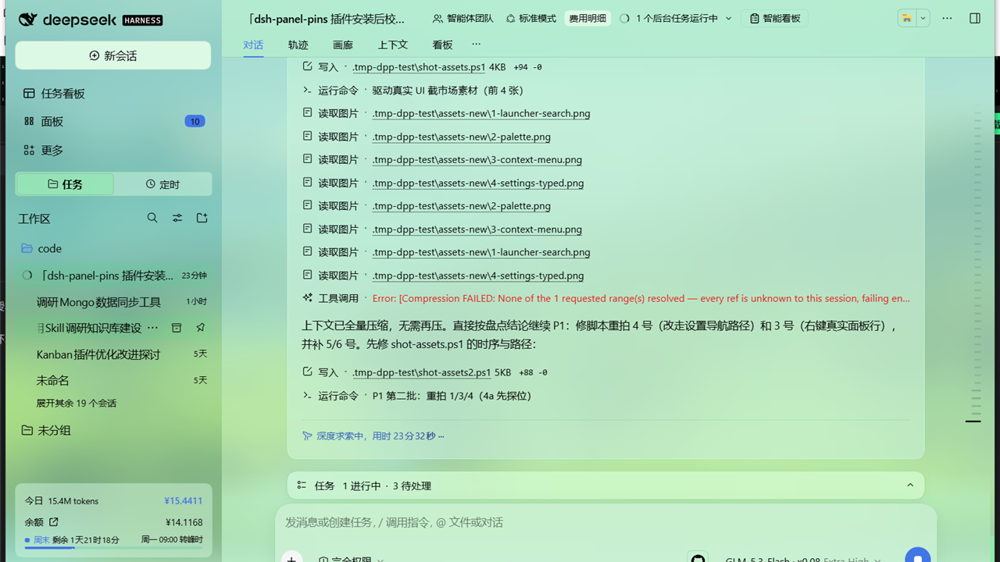
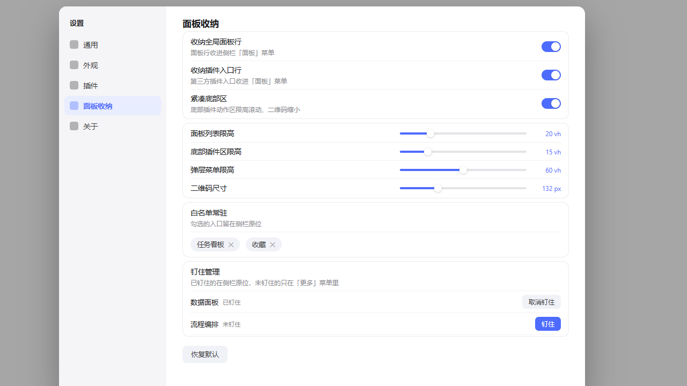
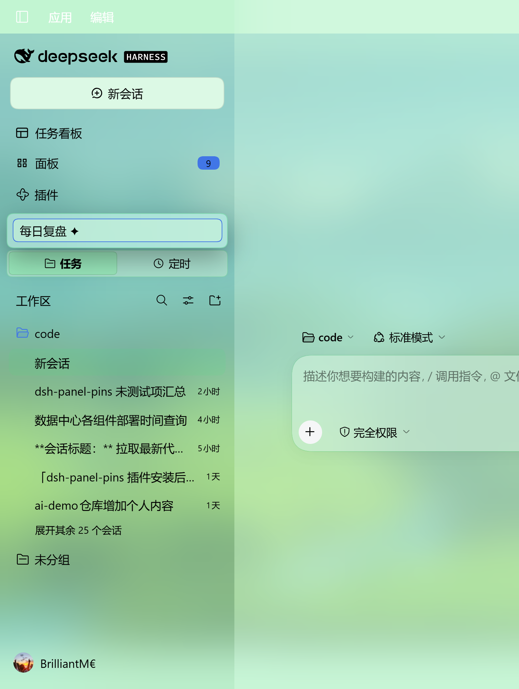
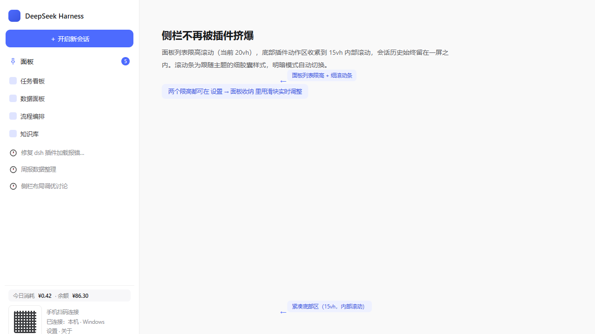

<p align="center"></p>

# dsh-panel-pins

[](https://www.npmjs.com/package/@qdnbd/dsh-panel-pins)
[](LICENSE)


[English](README.md) | **中文**

插件装得越多，侧栏越挤——想开的面板被挤没影，下面的会话列表也被压扁。**dsh-panel-pins 把侧栏的主动权还给你**：所有面板行与第三方插件入口收进一个可搜索的分组「面板」菜单，由你决定哪些入口留在侧栏、叫什么名字、排什么顺序——常用面板钉住，键盘一步直达，全部参数在设置页调整。

它只改显示层：卸载插件刷新页面后，宿主外观与安装前一模一样。

<p align="center">
  <a href="assets/screenshot-launcher.png"></a>
  <a href="assets/screenshot-palette.png"></a>
</p>
<p align="center">
  <a href="assets/screenshot-context.png"></a>
  <a href="assets/screenshot-settings.png"></a>
</p>
<p align="center">
  <a href="assets/screenshot-rename.png"></a>
  <a href="assets/screenshot-footer.png"></a>
</p>

## 功能

- **「面板」启动器**——侧栏一级行（与宿主行逐像素对齐），点开是分组菜单：
  - *全局面板*——**全量面板清单**（钉住与未钉住的都在），当前打开的高亮标记；未钉面板点开走「临时钉住」的 peek 流程，打开后自动还原钉住状态；
  - *插件入口*——自动识别第三方插件注入的入口行（零硬编码选择器，按「新会话锚点 ↔ 面板列表」之间的结构推导），菜单里点击直接触发**原按钮**，各插件自己的打开逻辑不受影响；
  - **菜单内搜索** + 全键盘导航（输入即过滤、↑↓ 移动、Enter 打开、Esc 关闭），**命中高亮**——命中的子串按主题强调色点亮；
  - **Alt+1..9 直达**——菜单 / 命令面板打开时按 Alt+数字，直接激活第 N 个**可见**项（折叠/被过滤的项自动跳过）；
  - **分组折叠记忆**——每组可折叠，重开菜单 / 重启应用都记得；
  - 悬停任意行出现**钉住 / 取消钉 / 置顶**快捷按钮；
  - 启动器徽标显示收纳总数，不会"悄悄丢东西"。
- **Ctrl+K 命令面板**——同一份面板清单 + 快捷命令（收纳行、仅图标、紧凑底部区、打开设置），居中弹出、键盘优先；宿主输入框聚焦时绝不抢键。
- **布局预设**（v1.0.0）——把整套布局（钉住、置顶、分组折叠、白名单、仅图标、紧凑底部区）存成具名预设；在命令面板或设置页一键应用 / 删除，适合「工作 / 娱乐」两套排布秒切。
- **自定义分组**（v1.0.0）——自建分组（如「常用」），在设置页改名、添加成员，菜单与命令面板里作为一等分组渲染——成员从全量清单抽出、各分组计数准确。
- **隐藏与重命名侧栏行**（v1.1.0）——右键任意行可从侧栏隐藏（在设置页或菜单「已隐藏」分组一键恢复），也可仅改显示名（**悬浮编辑器**：贴着原行下方弹出、随滚动/折叠实时跟随；侧栏每秒重渲染也不丢输入、不闪退；Enter 提交、Esc 取消；原名仍是钉住/分组/白名单的键）。存储 id 优先，宿主切换界面语言后依然生效。
- **最近使用**——菜单与命令面板顶部列出你最近打开的面板（MRU 上限 5、持久化），一键回到高频面板；与搜索、键盘导航、Alt+N 直达完全兼容。
- **右键上下文菜单**——任意侧栏行：打开 / 钉住 / 置顶 / 常驻侧栏 / 隐藏 / 重命名，全键盘可达（方向键、Home/End、Enter）。
- **面板行仅图标模式**——面板行保留位置但收成 18px 图标列，比整行收纳更温和的中间态。
- **钉住 / 取消钉住，重启后保留**——在侧栏「更多」菜单里加钉住项；已钉的在侧栏原位，未钉的从菜单可达。
- **面板置顶 + 拖拽排序**——把指定的面板行固定到面板列表最上方（侧栏收起时的窄栏图标同样生效），设置页里拖拽调整顺序。实现走 CSS `order` 负值重排，不动 DOM 结构、不怕宿主重渲染。
- **分组独立开关**——全局面板行、插件入口行可分别收纳，状态各自持久化。
- **紧凑底部区**（可开关，默认开）——底部插件动作区限高 15vh + 内部滚动，内联二维码缩小，品牌行与费用条收紧；二维码 / 品牌行 / 费用条各有细分开关，配高度滑块。
- **设置页分区**——*设置 → 面板收纳*：全部开关、四个实时滑块（面板列表 / 底部区 / 弹层 / 二维码尺寸）、**白名单常驻**（id 优先存储，UI 语言切换不失效）、**钉住管理**（全量一视图，已钉面板可置顶、可拖拽排序）、**配置导出 / 导入**（剪贴板 JSON，换机不丢配置）、一键恢复默认布局。
- **主题友好**——菜单表面与滚动条消费宿主主题 token（`--dsw-menu-surface-fill`、磨砂、滚动条 token），与 `dsh-any-background` 等壁纸插件天然兼容，无硬编码白底灰条。

## 安装

在 DeepSeek Harness 桌面端：**设置 → 插件**，从列出本插件的插件市场安装 `@qdnbd/dsh-panel-pins`，或终端执行：

```sh
dsh plugin --profile <your-profile> add @qdnbd/dsh-panel-pins
```

重启应用。

## 使用

- 点侧栏带数字徽标的**「面板」**行 → 分组、可搜索菜单打开任意面板 / 插件入口（钉住与未钉住的都在）；
- 任意界面按 **Ctrl+K** → 居中命令面板（快捷命令 + 全量清单）；
- **右键**任意侧栏行 → 打开 / 钉住 / 置顶 / 常驻侧栏 / 隐藏 / 重命名；
- **设置 → 面板收纳** → 完整控制台：开关、滑块、白名单、拖拽排序钉住管理、导出/导入、恢复默认布局。

## 配置

所有状态存在 `localStorage` 的 `dsh-panel-pins:` 前缀下，重启保留：

| 键 | 含义 |
| --- | --- |
| `rows-hidden-v2` | 全局面板行收进启动器 |
| `family-collected` | 插件入口行收进启动器 |
| `icon-only` | 面板行收成 18px 仅图标列 |
| `overlay-groups-folded` | 启动器菜单各组折叠记忆 |
| `tidy` / `tidy-qr` / `tidy-brand` / `tidy-meter` | 紧凑底部区总开关 + 细分开关 |
| `panel-list-max` / `foot-max` / `overlay-max` / `qr-size` | 各区域限高（vh/px） |
| `whitelist` | 常驻侧栏的入口（面板 id 优先，旧版 label 兜底兼容） |
| `unpinned` / `label-id-map` | 钉住状态与 label→id 记忆（钉住管理用） |
| `top` | 置顶面板 id 的有序列表（数组顺序 = 置顶顺序） |
| `hidden-rows` | 从侧栏隐藏的行（v2 id-first 条目 `{id,label}`；旧 label 数组自动迁移） |
| `display-renames` | 显示名覆盖（v2 id-first 条目 `{id,label,name}`；旧 label 映射自动迁移） |
| `layout-presets` / `active-preset` | 具名布局预设与最近应用的预设 |
| `custom-groups` | 用户自定义面板分组（id → {name, labels}） |
| `recent-panels` | 最近打开的面板（MRU，上限 5） |

## 说明

- 底部入口**永不**收进菜单——原地保留，只对容器做限高滚动；
- 插件不逐帧改写宿主样式表，全部通过类名 / CSS 变量门控，切换即时、无闪烁。

## 边界与安全

- **只改显示层**。隐藏与重命名只影响本机这份安装看到的画面——不动插件加载、不改插件注册名、不碰插件自己的配置。重命名是纯视觉覆盖：侧栏行、悬浮提示、无障碍名跟随你的命名；钉住、分组、白名单、命令面板一律仍以原名为键。
- **不做 DOM 手术**。排序用 CSS `order`、隐藏用 `display`、标记用 `data-dpp-*` 属性——不移动 React 节点、不打宿主补丁，宿主重渲染永远不会破坏布局。
- **卸载零残留**。全部状态都在 `dsh-panel-pins:` localStorage 前缀下；移除插件后刷新页面，宿主像素级还原。
- **主题 token 化**。菜单、悬浮层、滚动条全部消费宿主主题 token（`--dsw-alias-*` / `--dsh-*`），零硬编码颜色——亮色、暗色及 `dsh-any-background` 等第三方主题都兼容。

## 排错

- **装完没看到「面板」行**——重启一次应用，侧栏模块在启动时生成。
- **开启收纳后侧栏空了**——这正是收纳的本意 🙂；点「面板」行（或按 Ctrl+K）直达一切。想让某行永久留在侧栏：右键该行 →「常驻侧栏」。
- **重命名编辑器异常 / 输入丢失**——升级到 **v1.1.1+**：重命名编辑器已重写为挂 body 的悬浮层，侧栏每秒重渲染也不再丢输入。
- **开关切换后没反应**——刷新一次页面，可能是旧的 bundle revision 缓存。
- **宿主升级后插件消失 / 异常**——查看本仓 `package.json` 的 `engines.dsh` 兼容区间；超出区间时市场会隐藏插件，等发版放宽后即恢复。

## 许可

[MIT](LICENSE) © 2026 QDNBD
