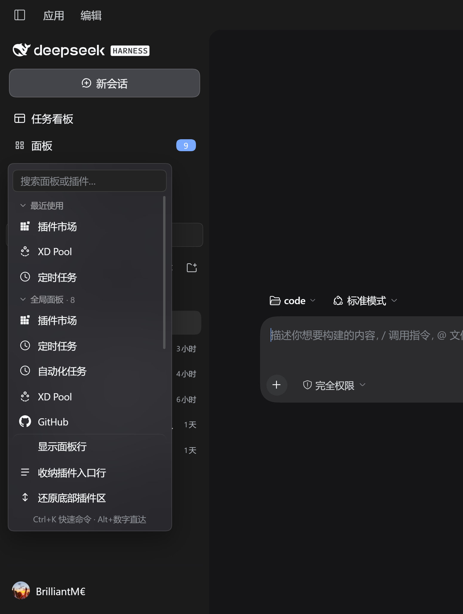
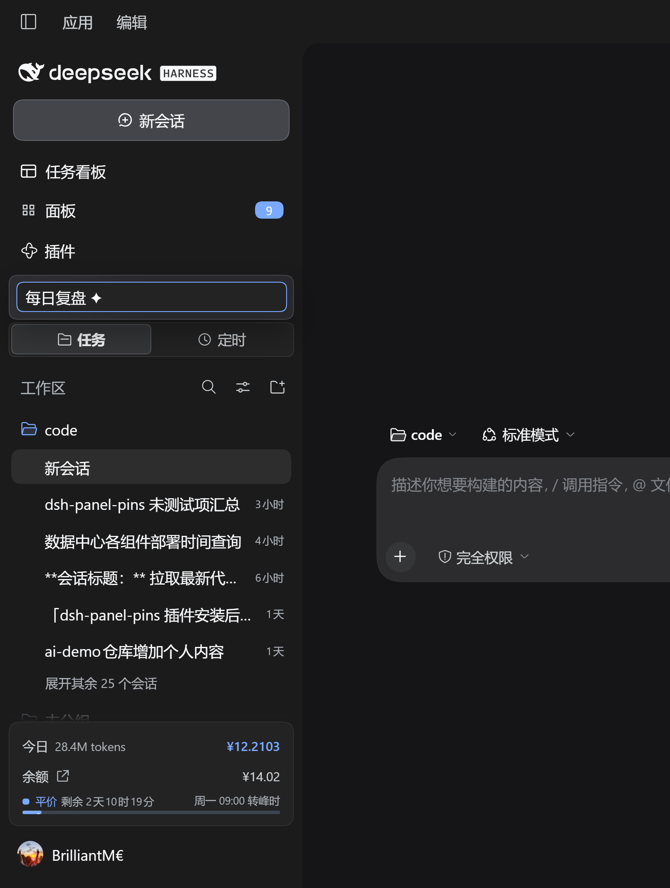
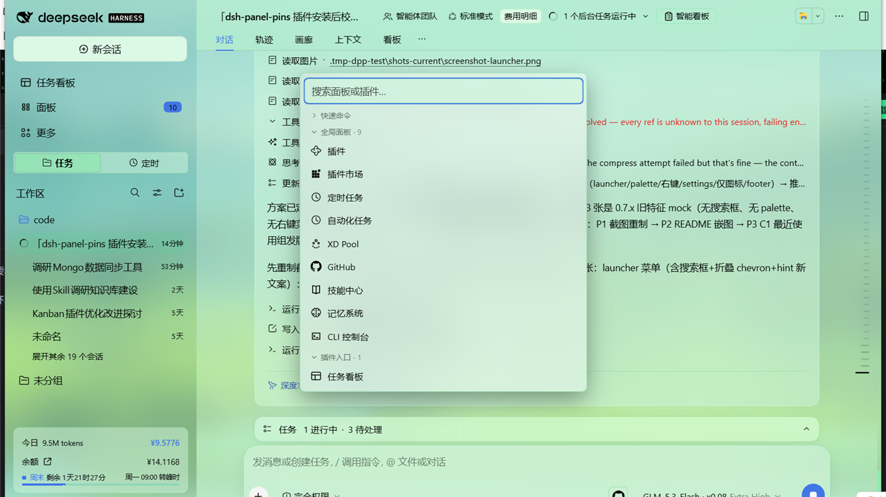
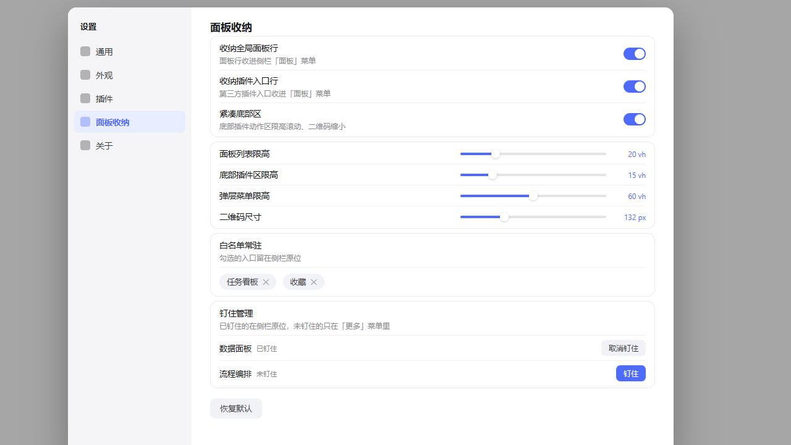
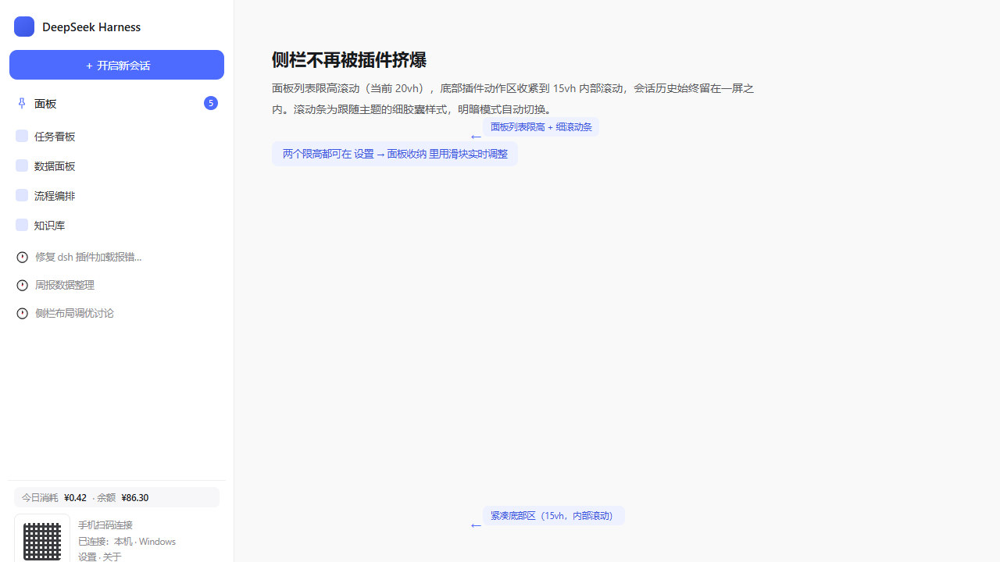

<p align="center"></p>

# dsh-panel-pins

[](https://www.npmjs.com/package/dsh-panel-pins)
[](https://www.npmjs.com/package/dsh-panel-pins)
[](LICENSE)


[English](README.md) | **中文**

插件装得越多，侧栏越挤——想开的面板被挤没影，下面的会话列表也被压扁。**dsh-panel-pins 把侧栏的主动权还给你**：所有面板行与第三方插件入口收进一个可搜索的分组「面板」菜单，由你决定哪些入口留在侧栏、叫什么名字、排什么顺序——常用面板钉住，键盘一步直达，全部参数在设置页调整。

它只改显示层：卸载插件刷新页面后，宿主外观与安装前一模一样。


<p align="center">
  <a href="assets/screenshot-launcher.png"></a>
  <a href="assets/screenshot-launcher-dark.png"></a>
</p>
<p align="center">
  <a href="assets/screenshot-rename.png"></a>
  <a href="assets/screenshot-rename-dark.png"></a>
</p>
<p align="center">
  <a href="assets/screenshot-palette.png"></a>
  <a href="assets/screenshot-context.png"></a>
</p>
<p align="center">
  <a href="assets/screenshot-settings.png"></a>
  <a href="assets/screenshot-footer.png"></a>
</p>

## 为什么选它

同类侧栏面板管理插件里，本插件是唯一的「键盘效率型启动器」——以下五项均为**独家能力**：

| 能力 | 本插件 | 其它同类（panel-control / panel-layout / panellist） |
| --- | :-: | :-: |
| **Ctrl+K 命令面板** | ✅ | ❌ |
| **菜单内搜索 + 命中高亮** | ✅ | ❌ |
| **Alt+1..9 直达** | ✅ | ❌ |
| **最近使用（MRU）** | ✅ | ❌ |
| **具名布局预设一键切换** | ✅ | ❌ |
| 兼容 **DSH ≥ 0.2.0-rc.1**（最宽） | ✅ | ❌（control / layout 要求 ≥ 0.2.1-rc.3） |
| 侧栏行直接拖拽排序 + 右键「移到最前」 | ✅（v1.2.2） | ✅ |
| AI 自动分类 | 规划中（v1.3） | ✅（仅 panel-control） |

> **老版本用户注意**：如果你的 DSH 是 **0.2.0-rc.2**（0.2.1-rc.3 之前的所有版本），panel-control 与 panel-layout 均无法安装——本插件与 panellist 是仅有的两个选择，而本插件是其中功能最全的。

## 功能

- **「面板」启动器**——侧栏一级行（与宿主行逐像素对齐），点开是分组菜单：
  - *全局面板*——**全量面板清单**（钉住与未钉住的都在），当前打开的高亮标记；未钉面板点开走「临时钉住」的 peek 流程，打开后自动还原钉住状态；
  - *插件入口*——自动识别第三方插件注入的入口行（零硬编码选择器，按「新会话锚点 ↔ 面板列表」之间的结构推导），菜单里点击直接触发**原按钮**，各插件自己的打开逻辑不受影响；
  - **菜单内搜索** + 全键盘导航（输入即过滤、↑↓ 移动、Enter 打开、Esc 关闭），**命中高亮**——命中的子串按主题强调色点亮；
  - **Alt+1..9 直达**——菜单 / 命令面板打开时按 Alt+数字，直接激活第 N 个**可见**项（折叠/被过滤的项自动跳过）；
  - **分组折叠记忆**——每组可折叠，重开菜单 / 重启应用都记得；
  - 悬停任意行出现**钉住 / 取消钉 / 置顶**快捷按钮；
  - 启动器徽标显示收纳总数，不会"悄悄丢东西"。
- **Ctrl+K 命令面板**——同一份面板清单 + 快捷命令（收纳行、仅图标、紧凑底部区、打开设置），居中弹出、键盘优先；宿主输入框聚焦时绝不抢键。
- **布局预设**（v1.0.0）——把整套布局（钉住、置顶、分组折叠、白名单、仅图标、紧凑底部区）存成具名预设；在命令面板或设置页一键应用 / 删除，适合「工作 / 娱乐」两套排布秒切。
- **自定义分组**（v1.0.0）——自建分组（如「常用」），在设置页改名、添加成员，菜单与命令面板里作为一等分组渲染——成员从全量清单抽出、各分组计数准确。
- **隐藏与重命名侧栏行**（v1.1.0）——右键任意行可从侧栏隐藏（在设置页或菜单「已隐藏」分组一键恢复），也可仅改显示名（**悬浮编辑器**：贴着原行下方弹出、随滚动/折叠实时跟随；侧栏每秒重渲染也不丢输入、不闪退；Enter 提交、Esc 取消；原名仍是钉住/分组/白名单的键）。存储 id 优先，宿主切换界面语言后依然生效。
- **最近使用**——菜单与命令面板顶部列出你最近打开的面板（MRU 上限 5、持久化），一键回到高频面板；与搜索、键盘导航、Alt+N 直达完全兼容。
- **右键上下文菜单**——任意侧栏行：打开 / 钉住 / 置顶 / 常驻侧栏 / 隐藏 / 重命名，全键盘可达（方向键、Home/End、Enter）。
- **面板行仅图标模式**——面板行保留位置但收成 18px 图标列，比整行收纳更温和的中间态。
- **钉住 / 取消钉住，重启后保留**——在侧栏「更多」菜单里加钉住项；已钉的在侧栏原位，未钉的从菜单可达。
- **面板置顶 + 拖拽排序**——把指定的面板行固定到面板列表最上方（侧栏收起时的窄栏图标同样生效），设置页里拖拽调整顺序。实现走 CSS `order` 负值重排，不动 DOM 结构、不怕宿主重渲染。
- **分组独立开关**——全局面板行、插件入口行可分别收纳，状态各自持久化。
- **紧凑底部区**（可开关，默认开）——底部插件动作区限高 15vh + 内部滚动，内联二维码缩小，品牌行与费用条收紧；二维码 / 品牌行 / 费用条各有细分开关，配高度滑块。
- **设置页分区**——*设置 → 面板收纳*：全部开关、四个实时滑块（面板列表 / 底部区 / 弹层 / 二维码尺寸）、**白名单常驻**（id 优先存储，UI 语言切换不失效）、**钉住管理**（全量一视图，已钉面板可置顶、可拖拽排序）、**配置导出 / 导入**（剪贴板 JSON + 配置文件）、一键恢复默认布局。
- **拖拽排序侧栏行，所见即所得**（v1.2.2）——直接在侧栏按住任意面板/插件行拖到目标位置，蓝色插入线实时指示落点，松手即排序；设置页钉住管理同样可拖；触屏/键盘兜底：右键行选「移到最前」。排序走 `row-order` 存储 + 负值 CSS `order`，不动 DOM、不怕宿主重渲染，重启保留；拖拽能力主动标记（b73 修复），手势永不丢失。
- **DSH 0.2.2-rc.3 深度适配**（v1.2.3–v1.3.1）——rc.3 侧栏 DOM 全面重构（DIV 行单元、嵌套行按钮、网格布局）后，本插件当日跟进：面板列表独立滚动（面板列表与会话区各自滚动，不再整栏连滚）、启动器行与宿主行**逐像素对齐**（32px 行高、5px/9px 内边距、6px 图标间距）、限高列表手动滚轮驱动、底部插件入口行也可收纳进「面板」菜单（可选开关）。
- **激活行豁免**（v1.3.2）——单行隐藏的面板，在你**正停在它里面**时临时回到侧栏（「人还在这个页面，入口不能消失」），离开即重新隐藏。收纳模式维持抑制优先（被收纳的行以「面板」抽屉为入口），白名单依旧压倒一切。纯显示层：隐藏存储、徽标计数与菜单列表均不受影响。
- **配置文件导出 / 导入**（v1.2.0）——剪贴板之外新增**文件通道**：设置页一键下载 `dsh-panel-pins-settings.json`，换机或重装后「从文件导入」一键还原全部布局；两种通道共用同一份导出构造与重放链路，带 `__plugin` 哨兵校验——外来 JSON 一律拒绝。
- **拖放导入配置**（v1.2.1）——把配置 JSON 直接拖到设置页面板上即导入，与文件通道同一校验链；**隐藏行「全部恢复」**（≥2 行时出现）与**菜单快捷键提示行**（输入即搜 · Enter 打开 · Esc 关闭 · Alt+数字直达 · Ctrl+K）同版交付。
- **主题友好**——菜单表面与滚动条消费宿主主题 token（`--dsw-menu-surface-fill`、磨砂、滚动条 token），与 `dsh-any-background` 等壁纸插件天然兼容，无硬编码白底灰条。

## 安装

**v1.2.0 起主包名（推荐）：**

```sh
dsh plugin --profile <your-profile> add dsh-panel-pins
```

在 DeepSeek Harness 桌面端也可：**设置 → 插件**，从插件市场安装。

> **单包名时代（v1.2.2 起）**：npm 上只发裸名 **`dsh-panel-pins`**。旧 `@qdnbd/dsh-panel-pins` 已冻结在 1.2.1（旧版本安装时会显示迁移提示）——请在插件市场重装裸名包完成迁移；设置 → 面板收纳 → 导出/导入 可带走全部配置。
> 国内用户：npmmirror 镜像会自动同步本包，无需额外配置。

重启应用。

## 使用

- 点侧栏带数字徽标的**「面板」**行 → 分组、可搜索菜单打开任意面板 / 插件入口（钉住与未钉住的都在）；
- 任意界面按 **Ctrl+K** → 居中命令面板（快捷命令 + 全量清单）；
- **右键**任意侧栏行 → 打开 / 钉住 / 置顶 / 常驻侧栏 / 隐藏 / 重命名；
- **设置 → 面板收纳** → 完整控制台：开关、滑块、白名单、拖拽排序钉住管理、导出/导入、恢复默认布局。

## 配置

所有状态存在 `localStorage` 的 `dsh-panel-pins:` 前缀下，重启保留：

| 键 | 含义 |
| --- | --- |
| `rows-hidden-v2` | 全局面板行收进启动器 |
| `family-collected` | 插件入口行收进启动器 |
| `icon-only` | 面板行收成 18px 仅图标列 |
| `overlay-groups-folded` | 启动器菜单各组折叠记忆 |
| `tidy` / `tidy-qr` / `tidy-brand` / `tidy-meter` | 紧凑底部区总开关 + 细分开关 |
| `panel-list-max` / `foot-max` / `overlay-max` / `qr-size` | 各区域限高（vh/px） |
| `whitelist` | 常驻侧栏的入口（面板 id 优先，旧版 label 兜底兼容） |
| `unpinned` / `label-id-map` | 钉住状态与 label→id 记忆（钉住管理用） |
| `top` | 置顶面板 id 的有序列表（数组顺序 = 置顶顺序） |
| `hidden-rows` | 从侧栏隐藏的行（v2 id-first 条目 `{id,label}`；旧 label 数组自动迁移） |
| `display-renames` | 显示名覆盖（v2 id-first 条目 `{id,label,name}`；旧 label 映射自动迁移） |
| `layout-presets` / `active-preset` | 具名布局预设与最近应用的预设 |
| `custom-groups` | 用户自定义面板分组（id → {name, labels}） |
| `recent-panels` | 最近打开的面板（MRU，上限 5） |
| `dsh-panel-pins-settings.json`（文件） | v1.2.0：全部上述状态的文件快照（导出/导入） |

## 说明

- 底部入口**永不**收进菜单——原地保留，只对容器做限高滚动；
- 插件不逐帧改写宿主样式表，全部通过类名 / CSS 变量门控，切换即时、无闪烁。

## 边界与安全

- **只改显示层**。隐藏与重命名只影响本机这份安装看到的画面——不动插件加载、不改插件注册名、不碰插件自己的配置。重命名是纯视觉覆盖：侧栏行、悬浮提示、无障碍名跟随你的命名；钉住、分组、白名单、命令面板一律仍以原名为键。
- **不做 DOM 手术**。排序用 CSS `order`、隐藏用 `display`、标记用 `data-dpp-*` 属性——不移动 React 节点、不打宿主补丁，宿主重渲染永远不会破坏布局。
- **卸载零残留**。全部状态都在 `dsh-panel-pins:` localStorage 前缀下；移除插件后刷新页面，宿主像素级还原。
- **主题 token 化**。菜单、悬浮层、滚动条全部消费宿主主题 token（`--dsw-alias-*` / `--dsh-*`），零硬编码颜色——亮色、暗色及 `dsh-any-background` 等第三方主题都兼容。

## 排错

- **装完没看到「面板」行**——重启一次应用，侧栏模块在启动时生成。
- **开启收纳后侧栏空了**——这正是收纳的本意 🙂；点「面板」行（或按 Ctrl+K）直达一切。想让某行永久留在侧栏：右键该行 →「常驻侧栏」。
- **重命名编辑器异常 / 输入丢失**——升级到 **v1.1.1+**：重命名编辑器已重写为挂 body 的悬浮层，侧栏每秒重渲染也不再丢输入。
- **开关切换后没反应**——刷新一次页面，可能是旧的 bundle revision 缓存。
- **宿主升级后插件消失 / 异常**——查看本仓 `package.json` 的 `engines.dsh` 兼容区间；超出区间时市场会隐藏插件，等发版放宽后即恢复。

## 许可

[MIT](LICENSE) © 2026 QDNBD
