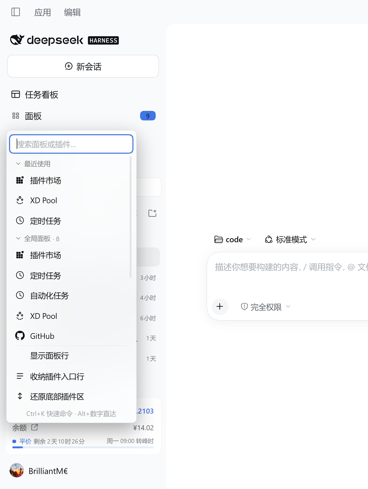
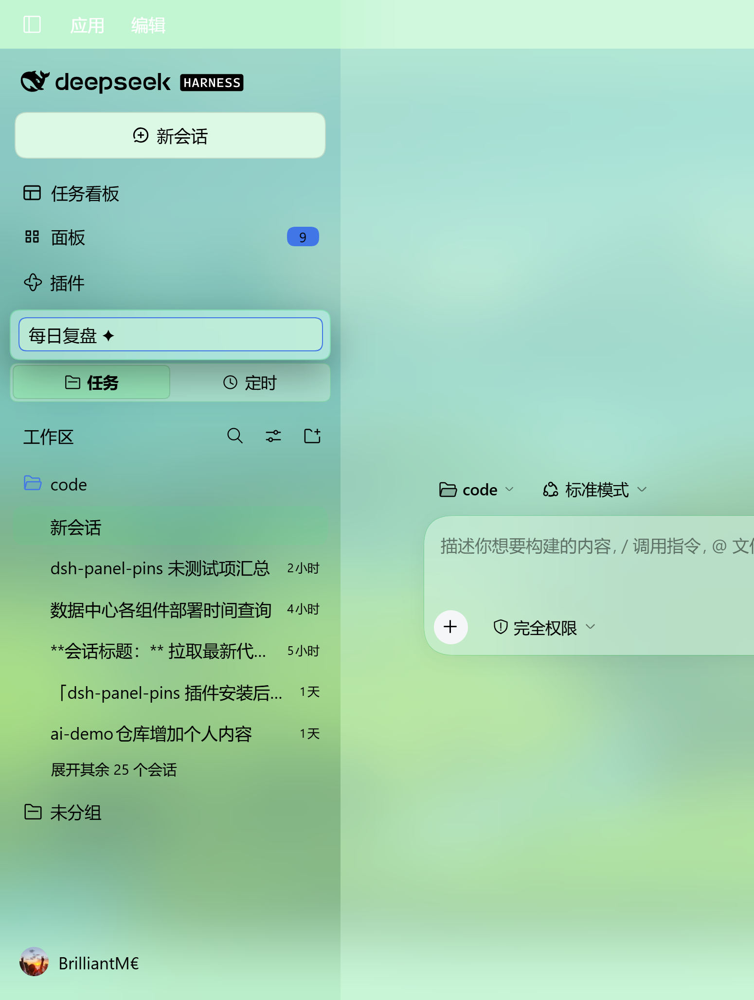
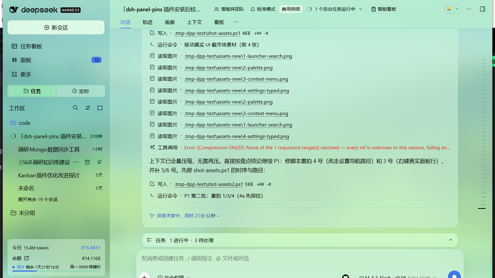

<p align="center"></p>

# dsh-panel-pins

[](https://www.npmjs.com/package/dsh-panel-pins)
[](https://www.npmjs.com/package/dsh-panel-pins)
[](LICENSE)


[English](README.md) | **中文**

**侧栏面板的键盘启动器。** 按 `Ctrl+K`，打两个字，回车——面板、插件入口、连只注册了设置页的第三方页面，全在同一个可搜索的菜单里。侧栏从此只留你真正想看的行。

```sh
dsh plugin --profile <你的 profile> add dsh-panel-pins
```

装到第十个插件，侧栏就失控了：常用的被挤进「更多」，会话列表压成一条缝，为了打开一个面板要先滚动、再展开、再翻找。

**dsh-panel-pins 的答案不是把侧栏排整齐，而是让你不必打开侧栏。**


<p align="center">
  <a href="assets/screenshot-launcher.png"></a>
  <a href="assets/screenshot-launcher-dark.png"></a>
</p>
<p align="center">
  <a href="assets/screenshot-palette.png"></a>
  <a href="assets/screenshot-rename.png"></a>
</p>
<p align="center">
  <a href="assets/screenshot-context.png"></a>
  <a href="assets/screenshot-settings.png"></a>
</p>

## ✨ 亮点

- **⌨️ 两键直达任何面板** — 全局 `Ctrl+K` 命令面板，输入即搜、命中高亮；`Alt+1..9` 直达第 N 项，最近使用自动置顶——侧栏从此变成可选项。键位已注册进**宿主自己的快捷键系统**：`设置 → 快捷键` 里能改键、看冲突。
- **🔤 拼音也能搜** — 输入 `mbsn` 找到「面板收纳」、`mianban` 找到「面板」。内置完整 GB2312 常用字表（6763 字），**纯本地、零外发、零联网**；命中按相关度排序，最佳命中排第一行。
- **🖱️ 随意拖动，想放哪就放哪** — 按住任意面板/插件行直接拖到目标位置，**蓝色插入线**实时指示落点；侧栏和钉住管理器里都能拖，触屏/键盘用户还有右键「移到最前」兜底，挪乱了也能一键恢复默认顺序。
- **✏️ 每一行都听你的** — 右键隐藏、行下悬浮编辑器重命名、钉住、置顶；只改显示层，重启不丢、切语言不乱。
- **💾 具名布局预设** — 钉住、折叠、仅图标、紧凑底部打包成一个快照，「工作」↔「娱乐」在命令面板里一键切换。
- **🧲 没有够不着的入口** — 连只注册了设置页的第三方插件，也会把完整页面变成菜单里的一行；只注册了**主面板**（没有侧栏行）的插件同样会被收进「主面板」分组；宿主自己的**右栏标签页类型**也单独成组。
- **🌐 跟着宿主的语言与主题走** — 直接读宿主自己的语言设置（8 种语言，应用内可切），切换即刻生效；主题也实时跟随，不再慢半拍。
- **🧊 侧栏保持纤细** — 仅图标模式（18px 图标列）+ 紧凑底部区四项独立限高，会话列表不再被挤成一条缝。
- **🛡️ 零风险、零残留** — 只动显示层、不做 DOM 手术、宿主重渲染冲不垮；卸载即像素级复原。亮色/深色/壁纸插件全兼容。

## 它解决什么

| 你现在的处境 | 装完之后 |
| --- | --- |
| 侧栏十几行，常用的那几个被挤进「更多」 | 全部收进一个「面板」菜单，侧栏只留你钉住的行 |
| 开个面板要滚动 → 展开 → 找 | `Ctrl+K` 输入两字回车；菜单开着时 `Alt+1..9` 直达 |
| 插件名又长又看不懂 | 右键重命名，只改本机显示，原名仍是键 |
| 只注册了设置页、没有侧栏入口的插件无处可达 | v1.4 桥接：它的设置页直接变成菜单里的一行 |
| 宿主设成中文，插件却还是英文 | v1.6：插件读宿主自己的语言设置，你一改它就跟着改 |
| 工作一套排布、娱乐一套排布，每次手动挪 | 存成具名预设，命令面板里一键切 |

## 为什么选它

十一个同类插件（`panel-control`、`panel-layout`、`panellist`、`panel-compact`、`panel-tidy`、`panel-titlebar`、`panel-order`、`panel-folders`、`panel-collapse`、`panel-fold`、本插件）里，只有它做到这六件事：

1. **让你不打开侧栏。** 全局 `Ctrl+K` 命令面板 + 菜单内搜索（命中高亮）+ `Alt+1..9` 直达 + 最近使用 MRU——其余十家一件都没有。
2. **键位归宿主管。** `Ctrl+K` 注册进宿主自己的快捷键服务：`设置 → 快捷键` 里能改键位、能看冲突、能看它和宿主其它命令的冲突；不在输入框里时宿主自己判断要不要触发，不再靠插件猜。
3. **中文用户能搜到。** 拼音首字母（`mbsn` → 面板收纳）、全拼（`mianban` → 面板）、模糊子序列三层匹配，内置 GB2312 常用字表，**纯本地零外发**；命中按相关度排序。
4. **整套布局可以存成预设。** 钉住、置顶、折叠、白名单、仅图标、紧凑底部区，一份 JSON 存下来，切场景一键还原。
5. **它说的就是宿主的语言。** 插件直接读宿主自己的语言设置与主题——宿主是中文，它就不会回英文；语言或主题一变，立刻跟着变。
6. **兼容区间最宽。** 要求 `DSH ≥ 0.2.0-rc.1` + `Node ≥ 20`；`panel-control` / `panel-layout` 要 `≥ 0.2.1-rc.3`，`panel-layout` / `panel-tidy` / `panellist` 还要 `Node ≥ 22`。

### 完整对照（2026-11-26，各插件各自最新版）

> 只列事实，不贬低竞品。**同一时间建议只启用一个**——它们改同一批侧栏节点，同时开会互相顶掉。

| 能力 | **本插件 1.7.0** | [panel-control 0.10.7](https://www.npmjs.com/package/dsh-panel-control) | [panel-layout 0.2.5](https://www.npmjs.com/package/dsh-panel-layout) | [panellist 0.2.0](https://www.npmjs.com/package/dsh-panellist) | [panel-compact 0.1.0](https://www.npmjs.com/package/dsh-panel-compact) | [panel-tidy 0.2.1](https://www.npmjs.com/package/dsh-panel-tidy) | [panel-titlebar 0.3.4](https://www.npmjs.com/package/dsh-panel-titlebar) |
| --- | :-: | :-: | :-: | :-: | :-: | :-: | :-: |
| **Ctrl+K 全局命令面板** | ✅ | — | — | — | — | — | — |
| **键位注册进宿主快捷键系统（可改键/看冲突）** | ✅ | — | — | — | — | — | — |
| **拼音首字母 / 全拼 / 模糊匹配** | ✅ | — | — | — | — | — | — |
| **命中按相关度排序** | ✅ | — | — | — | — | — | — |
| **菜单内搜索 + 命中高亮** | ✅ | — | — | — | — | — | — |
| **Alt+1..9 直达可见项** | ✅ | — | — | — | — | — | — |
| **最近使用（MRU，上限 5）** | ✅ | — | — | — | — | — | — |
| **具名布局预设一键切换** | ✅ | — | — | — | — | — | — |
| **宿主原生 Pin 共存（插件退为持久化镜像，原生取消固定不再被复活）** | ✅ v1.7 | — | — | — | — | — | — | — |
| **界面语言跟随宿主语言设置** | ✅ v1.6 | — | — | — | — | — | — | — |
| **主题实时跟随宿主（无 5 秒滞后）** | ✅ v1.6 | — | — | — | — | — | — | — |
| 侧栏行收进分组菜单 | ✅ 全局面板／插件入口／设置页／主面板／右栏标签页五类 | ✅ 分组树 | 部分：只收溢出项与左下角三项 | ✅ 分组 flyout | ✅ 只留 3 行 | ✅ 拖进「更多」 | — |
| 侧栏行直接拖拽排序 | ✅ 蓝色插入线 | ✅ 行首把手 | ✅ | ✅ | ✅ | — |
| 隐藏 / 重命名 | ✅ / ✅ 悬浮编辑器 | ✅ / ✅ | 仅溢出收纳 / — | ✅ / ✅ | — / — | — / — | — |
| 自定义分组 | ✅ | ✅ | — | ✅ | — | — | — |
| 分组折叠记忆 | ✅ | ✅ | — | —（flyout 菜单） | — | — | — |
| 只注册设置页的插件桥接进菜单 | ✅ v1.4 全量（含自身设置页） | ✅ | — | — | — | — | — |
| 只注册**主面板**的插件桥接进菜单 | ✅ v1.5 | — | — | — | — | — | — |
| 配置导出 / 导入 | ✅ 剪贴板 + 文件 + 拖放 | — | — | ✅ 文件 | — | — | — |
| 侧栏区域限高 | ✅ 四个独立滑块 | ✅ 自适应 | ✅ | — | — | — | — |
| 激活页临时豁免 | ✅ | —（仅自身保护） | — | ✅ | — | — | — |
| 换图标（内置图形 / 粘贴 SVG） | — | — | — | ✅ 24 个内置 | — | — | — |
| 按钮行 / 列表布局切换 + 行数上限 | 仅图标中间态 | — | ✅ 1–3 行 | — | — | — | — |
| 吸收左下角「更多」 | — | — | ✅ | — | — | — | — |
| 面板行搬进 Windows 标题栏 | — | — | — | — | — | — | ✅ |
| AI 自动分类 | — | ✅（会把入口名发给模型服务商） | — | — | — | — | — |
| 触屏可拖 / 长按进入拖动态 | 触屏用「移到最前」 | — | 触屏用向上箭头 | — | ✅ | ✅ 长按 500ms | — |
| 兼容区间 | **≥ 0.2.0-rc.1 / Node ≥ 20** | ≥ 0.2.1-rc.3 | ^0.2.1-rc.3 / Node ≥ 22 | ≥ 0.2.0-rc.2 / Node ≥ 22 | ≥ 0.2.0 | ≥ 0.2.0 / Node ^22.19 | ≥ 0.2.1-0 |

> 其余四个单一功能插件：`panel-order`（纯排序）、`panel-folders`（可折叠分组）、`panel-collapse`（折叠面板列表）、`panel-fold`（收进「更多」）。
>
> 数据来源：npm registry 各包 `latest` 与其 README（2026-11-25 抓取）。表格只记事实，选谁看你的优先级——见文末[「怎么选」](#怎么选)。

## 功能

### 一、「面板」启动器：六类分组收全部

侧栏一级行（与宿主行逐像素对齐），点开是一个分组菜单，徽标显示收纳总数——不会「悄悄丢东西」：

| 分组 | 里面是什么 |
| --- | --- |
| **全局面板** | 全量面板清单（钉住与未钉住都在），当前打开的高亮；未钉面板点开走「临时钉住」peek，打开后自动还原 |
| **插件入口** | 自动识别第三方插件注入的入口行（零硬编码选择器，按「新会话锚点 ↔ 面板列表」的结构推导），点击直接触发**原按钮**，各插件自己的打开逻辑不受影响 |
| **设置页** | v1.4：只注册了设置页、没有侧栏入口的第三方插件，一整页搬进菜单，点一行在主栏打开完整页面 |
| **主面板** | v1.5：只注册了**主面板**（根级 `main` 槽）、同样没有侧栏行的第三方插件，点一行直接在主栏打开。宿主自己的会话列与已桥接的设置页自动排除 |
| **最近使用** | MRU 上限 5、持久化，高频面板永远在顶上 |
| **自定义分组** | 你自己建的分组（如「常用」），成员从全量清单抽出，各分组计数准确 |
| **已隐藏** | 你从侧栏隐藏掉的行都躺在这里，一键全部恢复 |

- **菜单内搜索**——输入即过滤，命中的子串按主题强调色点亮；`↑↓` 移动、`Enter` 打开、`Esc` 关闭。
- **拼音搜索（v1.5）**——除直接输入中文外，还能打**拼音首字母**（`mbsn` → 面板收纳）、**全拼**（`mianban` → 面板）、**模糊子序列**（`dpp` → dsh-panel-pins）。内置完整 GB2312 常用字表（6763 字），纯本地计算、不联网、不外发。
- **命中排序（v1.5）**——搜索时按相关度把最像的那条排到**组内第一行**（完全匹配 > 前缀 > 首字母 > 子串 > 模糊），清空搜索框即恢复原顺序。
- **`Alt+1..9` 直达**——按第 N 个**可见**项（被折叠／被过滤的自动跳过）。搜索排序后，`Alt+1` 就是最佳命中。
- **分组折叠记忆**——每组可折叠，重开菜单、重启应用都记得。
- **悬停快捷按钮**——任意行悬停出现钉住 / 取消钉 / 置顶。

### 二、`Ctrl+K` 命令面板

同一份面板清单，外加一组快捷命令（收纳面板行、收纳插件入口、仅图标、紧凑底部区、打开设置）。居中弹出、键盘优先；**宿主输入框聚焦时绝不抢键**。

v1.5 起 `Ctrl+K` 注册进宿主的快捷键服务（`ctx.shortcuts`）：键位可以在 `设置 → 快捷键` 里改，冲突由宿主检测并显示；宿主自己判断当前焦点是不是输入框、是不是有模态弹窗，插件不再自己猜。老宿主（没有该服务）或宿主已占用 `Ctrl+K` 时自动回退到插件自己的监听，功能不受影响。macOS 上是 `⌘K`（与宿主其它快捷键一致）。

### 三、侧栏整理

- **钉住 / 取消钉住**——旧宿主在「更多」菜单里加入口，状态重启保留；宿主 0.2.2-rc.5 自带原生图钉后自动让位：不再重复渲染钉住行，转为**纯持久化镜像**——宿主的重启丢失由插件兜底恢复，你在原生图钉上的每次取消固定都会被记住。
- **置顶 + 拖拽排序**——按住任意面板/插件行拖到目标位置，**蓝色插入线**实时指示落点，松手即排序；设置页「钉住管理」同样可拖；触屏/键盘兜底：右键「移到最前」。排序走 `row-order` + 负值 CSS `order`，不动 DOM、不怕宿主重渲染。
- **恢复默认行序**——移过的行多了，设置页一键回到宿主原序。
- **隐藏**——右键任意行从侧栏移除，设置页或菜单「已隐藏」组恢复，≥2 行时出现「全部恢复」。
- **重命名**——纯显示层覆盖，**悬浮编辑器**贴着原行下方弹出、随滚动/折叠实时跟随，侧栏每秒重渲染也不丢输入（`Enter` 提交 / `Esc` 取消）。存储 id 优先，宿主换界面语言依然生效。
- **仅图标模式**——面板行保留位置，收成 18px 图标列，比整行收纳更温和的中间态。
- **白名单常驻**——某些行永远留在侧栏，压倒一切收纳规则（id 优先存储）。
- **激活行豁免**——单行隐藏的面板，你正停在它里面时临时回到侧栏；离开即重新隐藏。收纳模式维持抑制优先，白名单依旧最高。
- **分组独立开关**——全局面板行、插件入口行、底部插件入口行可分别收纳，状态各自持久化。

### 四、布局预设与自定义分组

把整套布局（钉住 / 置顶 / 分组折叠 / 白名单 / 仅图标 / 紧凑底部区）存成具名预设，命令面板或设置页一键应用、删除。「工作 / 娱乐」两套排布秒切。

### 五、紧凑底部区

底部插件动作区限高 15vh + 内部滚动，内联二维码缩小，品牌行与费用条收紧。二维码 / 品牌行 / 费用条各有细分开关，配高度滑块。底部入口**永不**收进菜单——原地保留，只对容器做限高滚动。

### 六、设置页：一个控制台

*设置 → 面板收纳*：

| 卡片 | 内容 |
| --- | --- |
| 开关区 | 收纳面板行 / 收纳插件入口 / 仅图标 / 紧凑底部区 / 设置页入口 / 三个细分开关 |
| 滑块区 | 面板列表限高、底部区限高、弹层菜单限高、二维码尺寸（实时生效） |
| 布局预设 | 存为预设 / 应用 / 删除 |
| 钉住管理 | 全量一视图，已钉面板可置顶、可拖拽排序 |
| 行排序 | 显示「已自定义 N 行」，一键恢复默认行序 |
| 自定义分组 | 建组、改名、用「＋面板」下拉添加成员 |
| 白名单常驻 | 编辑常驻列表 |
| 隐藏的行 / 重命名的行 | 逐条恢复 |
| 设置页入口 | 桥接开关 |
| 反馈与诊断 | GitHub issue / 问卷 / 复制诊断信息 |
| 导出与导入 | 剪贴板、配置文件、拖放三通道；恢复默认布局 |

### 七、设置页桥接（v1.4）

第三方插件只注册了设置页、没有侧栏入口时，它就是一个「装着但摸不到」的插件。v1.4 起菜单里多一个**设置页**分组：

- 页面经插件自己的注册面渲染（`inject` / `store` / `locale` 顶层字段原样透传），是**完整功能页**而非残缺镜像；
- 顶部一条「返回对话」，随时退回；
- 行只做增删对账（绝不交互中重挂载），一个开关整体收纳；
- 撤回时若正停在该页，自动落回对话；卸载干净无残留。

### 八、反馈与诊断（零自动上报）

设置页反馈卡 + 命令面板一条命令：

- **去 GitHub 提 issue**——预填标题与环境信息（插件版本 + 构建号、宿主版本、平台、语言），全部可删可改；
- **填写问卷**——打开**插件作者自己的**问卷（提交落在作者真的会看的表格里，绝不指向宿主官方问卷）；
- **复制诊断信息**——配置导出 + 环境块进剪贴板，是否粘贴进 issue 由你决定。

任何内容都不会被自动附到 URL 上，也没有任何后台上报。

### 九、迁移

- **剪贴板**：导出 JSON / 粘贴导入；
- **文件**：下载 `dsh-panel-pins-settings.json`，换机一键还原；
- **拖放**：把 JSON 直接拖到设置页面板上即导入；
- 三通道共用同一份导出构造与重放链路，带 `__plugin` 哨兵校验——外来 JSON 一律拒绝。

## 60 秒上手

| 我想…… | 怎么做 |
| --- | --- |
| 让侧栏清爽 | 设置 → 面板收纳 → 打开「收纳面板行」 |
| 立刻打开某个面板 | `Ctrl+K` → 输入名字 → `Enter` |
| 把某个行钉回侧栏 | 悬停该行 → 图钉；或右键 →「钉住」 |
| 给插件起个短名字 | 右键 →「重命名」→ 输入 → `Enter` |
| 挪一下顺序 | 按住行拖到目标位置（蓝色线 = 落点） |
| 存一套「工作」布局 | 调好 → 命令面板 →「保存当前布局为预设」 |
| 恢复出厂 | 设置 → 面板收纳 → 恢复默认布局 |

## 安装

```sh
dsh plugin --profile <你的 profile> add dsh-panel-pins
```

DeepSeek Harness 桌面端也可以：**设置 → 插件**，从插件市场搜索安装。装完**重启应用**一次（侧栏模块在启动时生成）。

> **单包名时代**：npm 上只发裸名 `dsh-panel-pins`。旧的 `@qdnbd/dsh-panel-pins` 冻结在 1.2.1，**不会再更新**。
>
> 如果你装的是旧 scoped 包：你现在跑的是 1.2.1，**没有**设置页桥接、布局预设、导出导入和拖拽排序。请改装裸名包（`dsh plugin --profile <你的 profile> add dsh-panel-pins`），然后在旧版设置页里「导出 / 导入」把配置搬过去（配置存在 `localStorage` 的 `dsh-panel-pins:` 键下，两个包名共用同一份前缀，导入即生效）。
> 国内用户：npmmirror 镜像会自动同步，无需额外配置。

## 配置

所有状态存在 `localStorage` 的 `dsh-panel-pins:` 前缀下，重启保留：

| 键 | 含义 |
| --- | --- |
| `rows-hidden-v2` | 全局面板行收进启动器 |
| `family-collected` / `footer-collected` | 插件入口行 / 底部插件入口行收进启动器 |
| `icon-only` | 面板行收成 18px 仅图标列 |
| `overlay-groups-folded` | 启动器菜单各组折叠记忆 |
| `tidy` / `tidy-qr` / `tidy-brand` / `tidy-meter` | 紧凑底部区总开关 + 三个细分开关 |
| `panel-list-max` / `foot-max` / `overlay-max` / `qr-size` | 各区域限高（vh/px） |
| `whitelist` | 常驻侧栏的入口（id 优先，旧版 label 兜底） |
| `unpinned` / `label-id-map` | 钉住状态与 label→id 记忆 |
| `top` | 置顶面板 id 的有序列表 |
| `row-order` | 拖拽/移动后的行序（覆盖宿主默认） |
| `hidden-rows` | 从侧栏隐藏的行（v2 id-first 条目） |
| `display-renames` | 显示名覆盖（v2 id-first 条目） |
| `layout-presets` / `active-preset` | 具名布局预设与最近应用 |
| `custom-groups` | 自定义面板分组 |
| `recent-panels` | 最近打开（MRU，上限 5） |
| `bridge` | 设置页桥接开关与状态 |

## 边界与安全

- **只改显示层。** 隐藏与重命名只影响本机这份安装看到的画面——不动插件加载、不改插件注册名、不碰插件自己的配置。重命名是纯视觉覆盖，钉住 / 分组 / 白名单 / 命令面板仍以原名为键。
- **不做 DOM 手术。** 排序用 CSS `order`、隐藏用 `display`、标记用 `data-dpp-*` 属性——不移动 React 节点、不打宿主补丁，宿主重渲染永远不会破坏布局。
- **卸载零残留。** 全部状态在 `dsh-panel-pins:` 前缀下；移除插件刷新页面，宿主像素级还原。
- **主题 token 化。** 菜单、悬浮层、滚动条全部消费宿主 `--dsw-*` / `--dsh-*` 主题 token，亮色、暗色与 `dsh-any-background` 等第三方壁纸插件都兼容。
- **零自动上报。** 只有你点击才会发出信息，内容先给你看。
- **只用公开契约。** 面板清单、设置页、钉住能力都走宿主公开槽位与可选服务；读取失败时降级为「不生效」，不会把插件本体带崩。

## 怎么选

十一个插件都在同一个侧栏上做文章，取向不同。**同一时间建议只启用一个**——它们改同一批侧栏节点，同时开会互相顶掉。

| 如果你的首要诉求是…… | 建议 |
| --- | --- |
| 侧栏越装越乱，想要一个入口收全部 + 键盘直达 | **本插件** |
| 只想要侧栏排整齐，顺手用鼠标拖 | 本插件 / panellist / panel-tidy 都行，本插件多搜索与命令面板 |
| 想要「按钮行 1–3 行」的网格外观 | panel-layout |
| 想把面板行搬进 Windows 标题栏，腾出整列纵向空间 | panel-titlebar |
| 只想留三行，其余进「更多」，配置越少越好 | panel-compact |
| 想让插件自动帮你分类 | panel-control |
| 想给每个面板换图标 | panellist |
| 触屏为主，要长按拖动 | panel-tidy |

## 排错

- **装完没看到「面板」行**——重启一次应用，侧栏模块在启动时生成。
- **开启收纳后侧栏空了**——这正是收纳的本意；点「面板」行或按 `Ctrl+K` 直达一切。
- **开关切换后没反应**——刷新一次页面，可能命中了旧的 bundle 缓存。
- **重命名编辑器异常 / 输入丢失**——升级到 v1.1.1+（编辑器已重写为挂 body 的悬浮层）。
- **宿主升级后插件消失**——看 `package.json` 的 `engines.dsh` 区间；超出时市场会隐藏插件，等发版放宽即恢复。

## 更新

活跃维护，通常每 1–3 天一个版本。近期：

- **1.7.0** — **Pin 双源收敛**：宿主 0.2.2-rc.5 自带原生图钉后，钉住状态一度存在两份（宿主内存 + 插件本地存储），在原生图钉上取消固定会被插件无声复活（真机实证：重开一次菜单行就回来）。现在插件检测到原生图钉就隐藏自己的钉住行，退为纯持久化镜像——**宿主管交互，插件管记忆**：每次原生取消固定都被记录，重启后由插件恢复，绝不再复活。旧宿主（无原生图钉）行为不变。
- **1.6.1** — 修复：侧栏「**新会话**」按钮看着空了一半——根源是插件自己的样式表命中面太宽：`[class*="_newSession"]` 把按钮内部的标签、内容 span 一起匹配上，多出来的下边距把「+ 新会话」文字顶到按钮垂直中心上方 8px。现在这条间距只作用在行上，文字回到正中
- **1.6.0** — 再加三件：宿主自己的**右栏标签页类型**进入菜单、单成一组（只收「页类型」——资源类型是按地址打开的、按名字打开会开出坏标签页）；**界面语言改跟宿主语言设置**（8 种语言、应用内可切），不再靠 `navigator.language` 猜；**主题实时跟随宿主**——原来的观察器盯的是宿主根本不碰的 `<html>` class，切主题最长要等五秒
- **1.5.0** — 三件事：`Ctrl+K` 注册进宿主快捷键服务（`设置 → 快捷键` 可改键、冲突可见、宿主自己仲裁输入框/模态）；搜索支持拼音首字母 / 全拼 / 模糊匹配并按相关度排序；只注册了**主面板**的第三方插件进入启动器「主面板」分组
- **1.4.8** — 修复 rc.5 限高列表滚轮仍然无效（1.4.4 起的免驱动限高版）：轻量驱动只接管列表可吸收的滚动步，边界步原样放行；同时回退 1.4.7 被截断的样式表（重复选择器行导致其后所有规则被解析器静默丢弃）——样式表恢复与 1.4.4 逐字节一致
- **1.4.7** — 应用户要求恢复 rc.5 限高面板列表：轻量滚轮驱动只接管列表可吸收的滚动步，列表到边界的事件原样放行给宿主手令（不做 stopPropagation、不代写视口）——列表与工作区首次同时正常
- **1.4.6** — rc.5 上插件完全让位滚动层：不再限高面板列表、不再接管滚轮（宿主滚动手令取代了限高的作用；任何插件自定义处理都会弄坏两个区域之一）
- **1.4.5** — 修复面板行列表自身滚不动（rc.5 视口处理器吞掉所有滚轮事件；现按宿主手令算法改为「列表先滚、溢出给视口」的链式驱动）
- **1.4.4** — 修复 rc.5 桌面端侧栏工作区滑不下去（rc.3 时代的结构覆盖 CSS 现按宿主滚动契约门控）
- **1.4.3** — 构建号（bNN）不再出现在用户可见界面，仅保留在 ?dppdebug 诊断里
- **1.4.2** — 自身设置页也进桥接，行数与设置页条目严格对齐
- **1.4.1** — 桥接全量铺开：每个 `settings.section` 都成为启动器里的一行
- **1.4.0** — 只有设置页的第三方插件进入「面板」菜单（主键面板 + 原 inject/store/locale 透传）
- **1.3.3** — 反馈与诊断：预填 issue、作者问卷、手动复制诊断，零自动上报
- **1.3.2** — 激活行豁免：人还在页面里，入口不消失
- **1.2.2** — 侧栏行直接拖拽排序 + 右键「移到最前」兜底

完整历史见 [Releases](https://github.com/QDNBD/dsh-panel-pins/releases)。

## 许可

[MIT](LICENSE) © 2026 QDNBD
